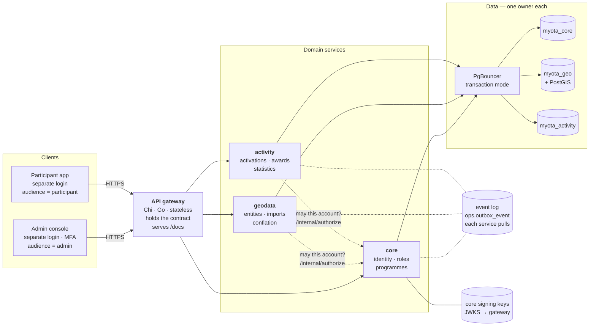

# Target architecture

MyOTA is a programme-agnostic activation platform: participants find eligible
places, activate them, log QSOs, and earn awards; administrators curate the place
catalogue, define programmes, and run award issuance.

This document describes the reconstructed system in `myota-new`. It keeps the
functional scope of the previous implementation and removes the structural
clutter that accumulated around it. The reasoning for each removal is in
[consolidation.md](consolidation.md).



Dashed arrows are the only asynchronous path: facts produced into a service's own
`ops.outbox_event` and pulled by consumers. There is no broker.

The block above is a Mermaid projection. The **authoritative** description is the
C4 model in [structurizr/workspace.dsl](structurizr/workspace.dsl), which also
carries a container view, two dynamic views, and the deployment view. When the two
disagree, the model is right.

Scaling is a property of every tier — see [scaling.md](scaling.md).

## Shape of the system

Six deployable units — four backend codebases plus two static front ends:

| Unit | Kind | Purpose | Database |
| --- | --- | --- | --- |
| `gateway` | stateless proxy + contract host | Single entry point, routing, edge policy, OpenAPI playground | none |
| `core` | domain service | Identity, sessions, callsigns, roles, programmes, content, **all email flows**, notifications | `myota_core` |
| `geodata` | domain service | Spatial catalogue, imports, conflation, review, provenance | `myota_geo` |
| `activity` | domain service | Activations, QSOs, ADIF import, awards, statistics | `myota_activity` |
| `admin-web` | static front end | Operator interface | none |
| `participant-web` | static front end | Participant interface | none |

Each domain service has **one image and three run modes**:

```
core      →  core-api      (HTTP, stateless, N replicas)
             core-worker   (consumes work jobs, N replicas)
             core-relay    (publishes this database's outbox, exactly 1 leader)
```

The modes share one codebase, one migration set, and one domain library. The old
system shipped twelve separate applications (`activity`, `activity-notifications`,
`activity-worker`, `email-worker`, `geodata`, `geodata-importer`,
`geodata-worker`, `identity`, `identity-maintenance`, `outbox-worker`,
`programmes`, `gateway`) with the outbox relay, idempotency, and dead-letter
logic copied into each. Here that plumbing exists once *per language* — in
`libs/ops/go` and `libs/ops/rust` — parameterised by the service's own database.
Two copies rather than twelve, with a shared conformance suite holding the
behaviour together; see [ADR-0002](../decisions/0002-language-per-service.md).

## The three databases are the service boundaries

This is the central simplification. The previous design had four domain services
sharing three databases, so `identity` and `programmes` both wrote `myota_core`
and neither could claim sole ownership. That is why ownership rules had to be
restated in prose and policed after the fact by a lint script
(`tools/check-database-ownership.mjs`).

Here, **one service owns one database, and nothing else may connect to it.**

| Database | Extension | Owned by | Holds |
| --- | --- | --- | --- |
| `myota_core` | — | `core` | Accounts, credentials, sessions, MFA, callsigns, roles, programmes, content, policy, jurisdiction, notifications |
| `myota_geo` | `postgis` | `geodata` | Entities, geometry, categories, media, sources, snapshots, imports, candidates, conflation, review, audit |
| `myota_activity` | — | `activity` | Activations, QSOs, corrections, log imports, award definitions, requests, issuances, statistics, work jobs |

Identity and Programmes live together because they are one bounded context:
programme configuration *is* authorization input. An `account_role` is scoped to
a programme; an `approver_scope` is scoped to a programme and entity type. Split
across two services on one database, every role check becomes a cross-service
call that cannot be transactional. Merged into `core`, the check is a join.

Cross-database links are opaque identifiers — `entity_id`, `programme_id`,
`account_id` — with no foreign keys and no distributed transactions. Ordering
and consistency come from the event log, not from the database engine.

## Integration

Services integrate asynchronously through **a durable event log in Postgres**, not
a message broker. Every service writes its committed events to its own outbox in
the same transaction as the domain change; consumers read them through an internal
HTTP feed with durable per-partition cursors. Work that needs competing consumers
uses a job table with `FOR UPDATE SKIP LOCKED` rather than a queue server.

Synchronous HTTP between services is not used to compose a user response. A
screen that needs two domains makes two calls from the front end. Three narrow
synchronous calls are permitted because they are integrity or authorization
checks rather than composition — scope introspection, entity geometry at
activation close, and deletion impact — each with a 2 s timeout and a documented
fallback. A chain of more than one synchronous hop is forbidden.

There is no NATS, no Redis, no RabbitMQ. The reasoning — including what it costs —
is in [ADR-0004](../decisions/0004-drop-message-broker.md) and
[messaging.md](messaging.md).

### Event contract

Events are CloudEvents-shaped and versioned in `contracts/events/`, one JSON
Schema per type, catalogued in `contracts/events/index.json`. This table and that
directory are checked against each other by `tools/check_events.py` — an event in
one and not the other fails the build.

| Event | Producer | Consumers |
| --- | --- | --- |
| `core.account.created.v1` | core | activity |
| `core.account.closed.v1` | core | activity, geodata |
| `core.programme.published.v1` | core | activity, geodata |
| `core.programme.archived.v1` | core | activity, geodata |
| `core.role.changed.v1` | core | activity, geodata (invalidate cached scopes) |
| `core.notification.requested.v1` | any service | core (the only sender) |
| `geodata.entity.published.v1` | geodata | activity |
| `geodata.entity.retired.v1` | geodata | activity |
| `geodata.import.completed.v1` | geodata | core (admin notification) |
| `activity.activation.closed.v1` | activity | core |
| `activity.award.issued.v1` | activity | core (notification) |

Two entries here disagreed with `messaging.md` before the contract set was written:
`activity.activation.started.v1` was listed with no consumer and no schema, and
`geodata.entity.published.v1` was said to feed a search index that this design does
not have. Both were removed. `messaging.md` is the specification; this table
describes it.

### Delivery rules

Every consumer assumes **at-least-once** delivery. The job id *is* the event id and
the insert is `ON CONFLICT DO NOTHING`, so a duplicate is a no-op rather than a
deduplication problem.

Ordering is per subject: `partition = hash(subject) % PARTITIONS`, and each
partition is consumed in `seq` order. Cross-aggregate ordering is not promised.

Retention is bounded by two rails — a 14-day ceiling and an ack floor reported by
live consumers — so the producer never trims past a consumer that is still
working. Lag is a metric, not a queue depth. See [messaging.md](messaging.md).

## The gateway owns the contracts

The previous gateway was a dumb proxy, and each service kept its own copy of the
OpenAPI document. Nothing served it, so the API-first rule was aspirational —
there was no Swagger UI anywhere in the deployment.

Here the gateway is the **only** holder of the contract set:

```
contracts/
  public.openapi.yaml      composed document — what the playground shows
  core.openapi.yaml
  geodata.openapi.yaml
  activity.openapi.yaml
  events/                  event schemas
```

- `GET /openapi.json` returns the composed document.
- `GET /docs` serves an interactive playground (Scalar or Swagger UI) with
  authorisation, try-it-out, and per-service filtering.
- Each service serves `GET /internal/openapi.json` for build-time composition and
  contract tests only; it is never exposed through the gateway.

Because the gateway compiles the contracts into its binary, a routing change and
a contract change land in the same commit and cannot drift.

See [gateway-and-contracts.md](gateway-and-contracts.md).

## Separate logins for admins and participants

Two front ends, two authentication surfaces, one identity store.

| | Participant | Admin |
| --- | --- | --- |
| Login entry | `/v1/auth/*` | `/v1/admin/auth/*` |
| Session cookie | `__Host-myota_sid` | `__Host-myota_admin_sid` |
| Token audience | `participant` | `admin` |
| Second factor | optional | **required** (TOTP or WebAuthn) |
| Session lifetime | 30 days idle / 90 days absolute | 30 minutes idle / 8 hours absolute |
| Requires role | any active account | active role with `admin.*` scope |
| Cookie path | `/` | `/` (audience-checked, not path-scoped) |

An admin session presented to a participant endpoint is rejected because the
audience does not match — not because of a role check that could be misconfigured.
The reverse is also true. Both audiences are issued by `core`, from the same
`account` table, so an operator can hold both an admin and a participant session
in one browser without either leaking into the other.

See [auth-model.md](auth-model.md).

## Email: registration, activation, recovery, address change

All four account-lifecycle flows live in `core` and share one primitive — a
single-use, hashed, expiring token bound to one account and one purpose.

| Flow | Token lifetime | Ends with |
| --- | --- | --- |
| Registration → activation | 24 h | account `pending` → `active` |
| Password recovery | 30 min | new password, **all sessions revoked** |
| Email change (two-sided) | 2 h | address changed, old address notified with a cancel link |

Nothing is sent inline. The handler writes a `notification` row in the same
transaction as the domain change, and `core-worker` delivers it with bounded
retries. The token and the email therefore commit together: if the send fails, the
token still exists and a resend works.

Two properties are load-bearing and easy to lose:

- **No enumeration.** Registration and recovery-request return an identical
  status, body and timing whether or not the address exists — including writing a
  token row on the miss path so the fast path is not detectably faster.
- **No flow reuse.** A `verify_email` token presented to the reset endpoint is
  rejected, not reinterpreted. Without that, every welcome email is an account
  takeover.

The legacy implementation had no email-change flow at all, so an address change
meant abandoning the account. It now requires the current password, notifies the
old address immediately with a one-click cancel, and does not take effect until
the new address confirms.

See [email-flows.md](email-flows.md).

## Geodata imports are kept, simplified

The import capability is the most valuable and most intricate part of the system,
so it is preserved — but collapsed from nine persisted stages to five, and from
three separately deployed processes (`geodata`, `geodata-worker`,
`geodata-importer`) to one service's worker mode.

```
Upload ──► Normalise ──► Validate ──► Conflate ──► Review ──► Publish
 (S3)      (adapters)   (bounded)    (scoring)   (admin)    (atomic)
```

Source adapters (who produced the data): `PARKSERVE_US`, `OSM`, `GOVERNMENT_GIS`,
`MANUAL`. Input formats (what the bytes are): GeoJSON, WFS GeoJSON, ArcGIS
FeatureServer JSON, KML, GPX, zipped Shapefile, OSM PBF, CSV+WKT. An adapter maps
one or more formats to the normalised feature stream.

Heavy parsing and geometry work runs in `geodata-worker`; the API only creates
runs and serves status.

See [geodata-imports.md](geodata-imports.md).

## Files live in Silo

Object storage is not a detail of the import pipeline — it holds five classes of
bytes with five different lifetimes, on a server shared with other tenants of this
cluster. Six buckets, three per environment, one credential per environment:

| Bucket | Holds | Lifetime |
| --- | --- | --- |
| `myota-<env>-imports` | import sources, log files | 30 days |
| `myota-<env>-content` | entity attachments | as long as the entity |
| `myota-<env>-records` | award certificates, callsign evidence | permanent; certificates write-once |

Uploads never traverse an API replica: the service mints a presigned URL for one
key and the browser sends the bytes straight to storage. That URL must be signed for
the public hostname, because the signature covers it and a browser cannot resolve a
ClusterIP.

Full detail, including the addressing rules and the permission policies:
[object-storage.md](object-storage.md).

## Deployment

Fleet workspace `myota` on the local K3s cluster, in namespace `myota-test` for
the test environment and `myota` for production.

| Environment | Namespace | Participant host | Admin host |
| --- | --- | --- | --- |
| test | `myota-test` | `myota-test.ea7klk.es` | `myota-admin-test.ea7klk.es` |
| production | `myota` | — | — |

Participant and admin are always a **pair of hostnames**, never one host with two
audiences behind a path — the same convention as `aprs.ea7klk.es` and
`aprs-admin.ea7klk.es`.

```
gateway            2–10   stateless; Traefik owns rate limiting and retries
core-api           2–20   core-worker    2–20   core-relay     1–32
geodata-api        2–20   geodata-worker  2–20   geodata-relay  1–32
activity-api       2–20   activity-worker 2–20   activity-relay 1–32
admin-web          2–10   participant-web 2–20
```

**Every workload is horizontally scalable with no session affinity.** Any replica
serves any request; killing one is invisible. The mechanisms — partition-leased
relays, idempotent consumers, a pre-deploy migration Job, schedule uniqueness,
PgBouncer for connection budgeting, presigned uploads that keep file bytes off the
API — are the contract in [scaling.md](scaling.md) and
[ADR-0005](../decisions/0005-horizontal-scaling.md).

The front ends are static trees with content-hashed assets and immutable cache
headers, so they consume no database connections and scale on network throughput
alone.

Configuration comes from ConfigMaps; secrets from SOPS-encrypted files applied
by an operator workflow. Sealed Secrets is not used — see
[secrets-and-config.md](secrets-and-config.md).

## Non-goals

Deliberately not carried forward:

- OIDC federation with external providers (a single provider hook remains, disabled by default).
- The public-registration-disabled response shape from the legacy API.
- Cases where the same concept exists in more than one service.
- Any synchronous service-to-service dependency in a user request path.
- Any message broker. The outbox is the log; consumers pull from it.
