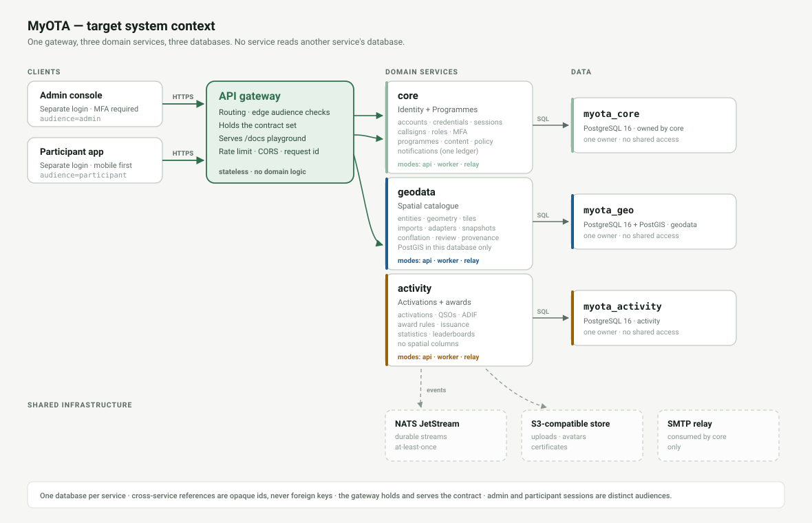

# Target architecture

MyOTA is a programme-agnostic activation platform: participants find eligible
places, activate them, log QSOs, and earn awards; administrators curate the place
catalogue, define programmes, and run award issuance.

This document describes the reconstructed system in `myota-new`. It keeps the
functional scope of the previous implementation and removes the structural
clutter that accumulated around it. The reasoning for each removal is in
[consolidation.md](consolidation.md).



## Shape of the system

Six deployable units — four backend codebases plus two static front ends:

| Unit | Kind | Purpose | Database |
| --- | --- | --- | --- |
| `gateway` | stateless proxy + contract host | Single entry point, routing, edge policy, OpenAPI playground | none |
| `core` | domain service | Identity, sessions, callsigns, roles, programmes, content, notifications | `myota_core` |
| `geodata` | domain service | Spatial catalogue, imports, conflation, review, provenance | `myota_geo` |
| `activity` | domain service | Activations, QSOs, ADIF import, awards, statistics | `myota_activity` |
| `admin-web` | static front end | Operator interface | none |
| `participant-web` | static front end | Participant interface | none |

Each domain service has **one image and three run modes**:

```
core      →  core-api      (HTTP, stateless, N replicas)
             core-worker   (consumes work jobs, N replicas)
             core-relay    (publishes this database's outbox, exactly 1 leader)
```

The modes share one codebase, one migration set, and one domain library. The old
system shipped twelve separate applications (`activity`, `activity-notifications`,
`activity-worker`, `email-worker`, `geodata`, `geodata-importer`,
`geodata-worker`, `identity`, `identity-maintenance`, `outbox-worker`,
`programmes`, `gateway`) with the outbox relay, idempotency, and dead-letter
logic copied into each. Here that plumbing exists once, in `libs/ops`, and is
parameterised by the service's own database.

## The three databases are the service boundaries

This is the central simplification. The previous design had four domain services
sharing three databases, so `identity` and `programmes` both wrote `myota_core`
and neither could claim sole ownership. That is why ownership rules had to be
restated in prose and re-checked by hand.

Here, **one service owns one database, and nothing else may connect to it.**

| Database | Extension | Owned by | Holds |
| --- | --- | --- | --- |
| `myota_core` | — | `core` | Accounts, credentials, sessions, MFA, callsigns, roles, programmes, content, policy, jurisdiction, notifications |
| `myota_geo` | `postgis` | `geodata` | Entities, geometry, categories, media, sources, snapshots, imports, candidates, conflation, review, audit |
| `myota_activity` | — | `activity` | Activations, QSOs, corrections, log imports, award definitions, requests, issuances, statistics, work jobs |

Identity and Programmes live together because they are one bounded context:
programme configuration *is* authorization input. An `account_role` is scoped to
a programme; an `approver_scope` is scoped to a programme and entity type. Split
across two services on one database, every role check becomes a cross-service
call that cannot be transactional. Merged into `core`, the check is a join.

Cross-database links are opaque identifiers — `entity_id`, `programme_id`,
`account_id` — with no foreign keys and no distributed transactions. Ordering
and consistency come from the event log, not from the database engine.

## Integration

Services integrate asynchronously through **NATS JetStream**. Synchronous HTTP
between services is not used to compose a user response; the gateway fans out
only when a single screen genuinely needs two domains, and it calls at most two
services.

### Event contract

Events are CloudEvents-shaped and versioned in `contracts/events/`. A minimal
registry:

| Event | Producer | Consumers |
| --- | --- | --- |
| `core.account.created.v1` | core | activity, geodata (cache warm) |
| `core.account.closed.v1` | core | activity, geodata |
| `core.programme.published.v1` | core | geodata, activity |
| `core.programme.archived.v1` | core | geodata, activity |
| `geodata.entity.published.v1` | geodata | activity (read model), core (search index) |
| `geodata.entity.retired.v1` | geodata | activity |
| `geodata.import.completed.v1` | geodata | core (admin notification) |
| `activity.activation.started.v1` | activity | core (optional notification) |
| `activity.activation.closed.v1` | activity | core, geodata (activation counters) |
| `activity.award.issued.v1` | activity | core (notification, certificate link) |
| `core.notification.requested.v1` | any | core |

### Delivery rules

Every consumer assumes **at-least-once** delivery and is idempotent by
`(consumer, event_id)`. Every producer writes the event to its own outbox in the
same transaction as the domain change, and a single relay per database publishes
after commit. Nothing is acked before the domain transaction commits.

## The gateway owns the contracts

The previous gateway was a dumb proxy, and each service kept its own copy of the
OpenAPI document. Nothing served it, so the API-first rule was aspirational —
there was no Swagger UI anywhere in the deployment.

Here the gateway is the **only** holder of the contract set:

```
contracts/
  public.openapi.yaml      composed document — what the playground shows
  core.openapi.yaml
  geodata.openapi.yaml
  activity.openapi.yaml
  events/                  event schemas
```

- `GET /openapi.json` returns the composed document.
- `GET /docs` serves an interactive playground (Scalar or Swagger UI) with
  authorisation, try-it-out, and per-service filtering.
- Each service serves `GET /internal/openapi.json` for build-time composition and
  contract tests only; it is never exposed through the gateway.

Because the gateway compiles the contracts into its binary, a routing change and
a contract change land in the same commit and cannot drift.

See [gateway-and-contracts.md](gateway-and-contracts.md).

## Separate logins for admins and participants

Two front ends, two authentication surfaces, one identity store.

| | Participant | Admin |
| --- | --- | --- |
| Login entry | `/v1/auth/*` | `/v1/admin/auth/*` |
| Session cookie | `__Host-myota_sid` | `__Host-myota_admin_sid` |
| Token audience | `participant` | `admin` |
| Second factor | optional | **required** (TOTP or WebAuthn) |
| Session lifetime | 30 days idle / 90 days absolute | 30 minutes idle / 8 hours absolute |
| Requires role | any active account | active role with `admin.*` scope |
| Cookie path | `/` | `/` (audience-checked, not path-scoped) |

An admin session presented to a participant endpoint is rejected because the
audience does not match — not because of a role check that could be misconfigured.
The reverse is also true. Both audiences are issued by `core`, from the same
`account` table, so an operator can hold both an admin and a participant session
in one browser without either leaking into the other.

See [auth-model.md](auth-model.md).

## Geodata imports are kept, simplified

The import capability is the most valuable and most intricate part of the system,
so it is preserved — but collapsed from nine persisted stages to five, and from
two worker applications to one worker mode.

```
Upload ──► Normalise ──► Validate ──► Conflate ──► Review ──► Publish
 (S3)      (adapters)   (bounded)    (scoring)   (admin)    (atomic)
```

Adapters: GeoJSON, Shapefile (zipped), GPX, OSM PBF, CSV + WKT. Heavy parsing
and geometry work runs in `geodata-worker`; the API only creates runs and serves
status.

See [geodata-imports.md](geodata-imports.md).

## Deployment

Namespace `myota`, Fleet workspace `myota`, on the local K3s cluster.

```
gateway            2 replicas
core-api           2   core-worker    2   core-relay      1
geodata-api        2   geodata-worker  2   geodata-relay   1
activity-api       2   activity-worker 2   activity-relay  1
admin-web          2   participant-web 2
```

Configuration comes from ConfigMaps; secrets from SOPS-encrypted files applied
by an operator workflow. Sealed Secrets is not used — see
[secrets-and-config.md](secrets-and-config.md).

## Non-goals

Deliberately not carried forward:

- OIDC federation with external providers (a single provider hook remains, disabled by default).
- The public-registration-disabled response shape from the legacy API.
- Cases where the same concept exists in more than one service.
- Any synchronous service-to-service dependency in a user request path.
