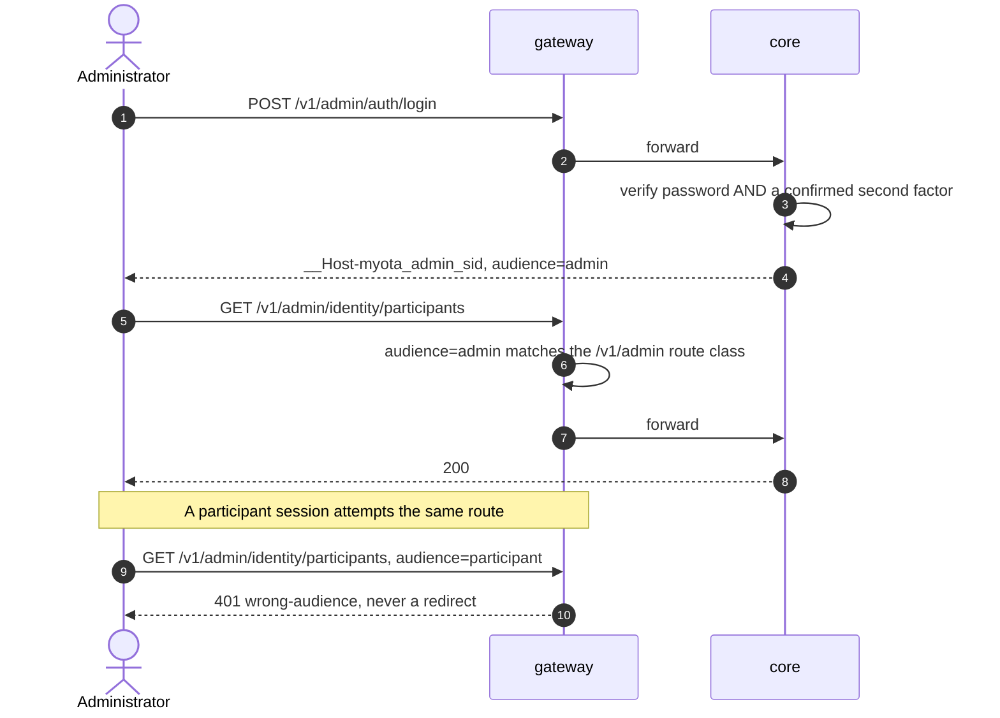

# Authentication model

Two audiences, one identity store, no shared session.

## The problem with the legacy model

Admin and participant were already separate front ends, but both called
`POST /v1/identity/auth/login` and both received the same kind of token. The only
separation was which browser storage key the front end used. That is a client-side
convention, not a security boundary: a token issued through the participant login
form was structurally identical to an admin token. Authorisation relied entirely
on scope checks at each endpoint.

The redesign makes the audience a property of the **session**, checked by the
server and by the gateway.

## Two login surfaces

```
POST /v1/auth/login          participant login  → audience=participant
POST /v1/auth/register       participant registration
POST /v1/admin/auth/login    admin login        → audience=admin, MFA required
```

| Aspect | Participant | Admin |
| --- | --- | --- |
| Endpoint prefix | `/v1/auth/*` | `/v1/admin/auth/*` |
| Audience claim | `participant` | `admin` |
| Second factor | optional | required |
| Session cookie | `__Host-myota_sid` | `__Host-myota_admin_sid` |
| Access token lifetime | 15 min | 10 min |
| Refresh lifetime | 30 days idle / 90 days absolute | 30 min idle / 8 h absolute |
| Login rate limit | 10 / 15 min per key | 5 / 15 min per key + per-account lockout |
| Precondition | active account | active account with an admin role |

`__Host-` prefixes force `Secure`, forbid `Domain`, and pin the path to `/`. Two
cookies with different names cannot overwrite each other, so an operator can be
signed into both apps in one browser without either session clobbering the other.

## Why not path-scoped cookies

The obvious alternative is to scope the admin cookie to `/v1/admin` and the
participant cookie to `/v1`. It fails for two reasons:

1. The admin UI and the gateway are on the same origin, so a participant page can
   still issue a request to `/v1/admin/...` and the browser will attach the admin
   cookie if the path matches.
2. Path scoping is enforced by the browser, not the server. A non-browser client
   ignores it entirely.

Audience checking is enforced server-side in one middleware, so it holds for every
caller.



## Token shape

```
{ "iss": "myota-core",
  "aud": "admin",              // or "participant"
  "sub": "<account uuid>",
  "sid": "<session uuid>",
  "jti": "<token uuid>",
  "scp": ["geodata.review"],   // admin only
  "iat": ..., "exp": ... }
```

The gateway verifies `aud` against the route prefix before proxying:

| Route prefix | Required audience |
| --- | --- |
| `/v1/admin/**` | `admin` — every administrator prefix, without exception |
| `/v1/auth/**` | anonymous (registration, sign-in, recovery) or `participant` |
| `/v1/me/**` | `participant` or `admin` — own-account operations |
| `/v1/activations/**`, `/v1/qsos/**`, `/v1/log-imports/**` | `participant` for their own data; `admin` for the read-only review routes the contract declares |
| `/v1/awards/**` | anonymous for definitions, `participant` for `mine` and requests |
| `/v1/proposals/**` | `participant` (create, own only) |
| `/v1/entities/**`, `/v1/imports/**` | anonymous for published reads, `admin` for writes and imports |
| `/v1/programmes/**`, `/v1/tiles/**`, `/v1/statistics/**` | anonymous |

The prefix list itself is generated from the contract:
`python3 tools/compose_contracts.py --routes`. Audience is a property of the route
*class*, not of the operation, which is why this table is written against prefixes.

A mismatch is `401` with `problem+json` type `about:blank#wrong-audience`, never a
redirect to a login page (which would leak which audience the route expects).

## MFA is mandatory for admins

An account with an admin role must have a confirmed `account_mfa` row before
`/v1/admin/auth/login` will issue a session. Enrolment happens once, through
`/v1/admin/auth/mfa/enrol`, which requires an existing admin session — so a new
admin is provisioned by another admin, then enrols on first login.

Supported: TOTP (`totp-rs`) and WebAuthn passkeys (`webauthn-rs`). Recovery
codes live in `account_recovery_code` as single-use hashes.

There is no "skip MFA" flag and no environment variable that disables it — not
even for local development, where a test admin is provisioned with a fixed TOTP
seed instead. If the operator loses the second factor, another admin resets it.
This is a deliberate operational cost in exchange for removing a bypass that can
be switched on by configuration.

## Authorization

Roles are rows, not a hierarchy:

```
role_definition:  role_code, display_name, scopes[]
account_role:     account_id, role_code, programme_id?, jurisdiction_code?, valid_to
```

Effective scopes for a request are the union of scopes from all open
`account_role` rows for the account, optionally narrowed by programme:

```
scope_granted?(account, scope, programme) =
    ∃ role ∈ open_roles(account)
      where scope ∈ role.scopes
        and (role.programme_id is null or role.programme_id = programme)
```

Checked in one place — an `authorize(scope, programme)` guard in `core` — and
re-exposed to other services as a signed introspection response. `geodata` and
`activity` never re-implement role logic; they ask `core` once per request and
cache the answer for the session lifetime.

This closes a real hole from the legacy system: the conflation read and resolve
endpoints required only a valid bearer token, not the `geodata.review` scope they
were documented to need.

## Two administration surfaces, not one

Managing an **admin** and managing a **participant** are different jobs with
different risk, different volume, and different people doing them. They are two
sections in the console, two scopes, and two sets of endpoints.

| | Admin accounts | Participant accounts |
| --- | --- | --- |
| Section | **Admins** | **Participants** |
| Scope | `identity.admins.manage` | `identity.participants.manage` |
| Why | granting authority is a privilege-escalation surface | day-to-day support at volume |
| Base route | `/v1/admin/identity/admins` | `/v1/admin/identity/participants` |
| Changes authority | yes — grants and revokes roles | no |
| Requires MFA on the actor | **yes, and re-auth within 5 min** | no |
| Audit level | every field change, with before/after | action log |
| Typical volume | tens | thousands |

### Why the split is not cosmetic

The two activities fail differently. An admin-management mistake is an escalation:
someone gains authority they should not have, and the damage is invisible until it
is used. A participant-management mistake is a support error: a callsign marked
verified that was not, an account deactivated by the wrong row. Those need
different guard rails, and a single "Users" screen gives neither.

It also matches how the scopes were already granted in the legacy system —
`identity.admin` for the user-and-access screen, `identity.participants.manage`
for the participant-only screen — which the previous implementation honoured in
its navigation and this redesign had collapsed. Restoring it.

### Rules for admin management

- **You cannot grant a role you do not hold yourself.** The scope check is
  `granted ⊆ actor_scopes`, evaluated at write time, not merely "has
  `identity.admins.manage`". Without this, the scope is equivalent to root.
- **You cannot remove your own last admin role**, so a console cannot be locked
  out by one click.
- **Re-authentication is required within five minutes** for any role change,
  MFA reset, or account suspension — a stolen session cannot be used to escalate.
- **Every change records actor, target, field, before and after**, in
  `security_event`, and appears in the admin's own audit view.
- **MFA state is visible and actionable**: enrolled, not enrolled, or reset. An
  admin without a confirmed second factor cannot sign in, so the screen must show
  who is blocked rather than leaving it to be discovered.
- **Active sessions are listed and revocable per session**, not just "log out
  everywhere". A suspicious session is identifiable by user agent and address.

### Rules for participant management

- **Callsign verification is the main job.** Evidence is reviewed, approved, or
  rejected, and the decision is attributed.
- **Registration state is visible**: `pending`, `active`, `closed`, plus whether
  the address is verified and whether mail has bounced. This is what turns "I
  never got the email" into a five-second answer.
- **Deactivation is reversible; deletion is not offered here.** Closing an account
  keeps the activation history intact and detaches references. A hard delete is a
  retention job, not a support button.
- **No role grants.** This scope cannot escalate anyone, by construction — the
  endpoints for role assignment are admin-surface only.
- **Paged and filterable from the start.** Thousands of rows, so the list is
  cursor-paged, searchable by callsign or address, and filterable by state.

### What the two sections share

Everything below the surface: the same `account` table, the same session,
cryptography and rate limiting, and the same audit log. The split is in
authorization and interface, not in data — which is why it costs two scopes and
two navigation entries rather than a second identity system.

## Session lifecycle

```
login ──► auth_session(audience, refresh_token_hash, access_jti)
              │
              ├── refresh ──► rotate refresh token, new access_jti
              │                 (old refresh row marked rotated)
              └── logout  ──► revoked_at = now(), jti → auth_revocation
```

- Refresh tokens rotate on every use. Reuse of a rotated token revokes the whole
  session and emits `security_event(type='refresh_reuse')`.
- Access tokens are not revocable individually except through `auth_revocation`,
  which is checked by `core` for admin routes and by the gateway for every
  audience-tagged route.
- Password change revokes every session except the current one.
- Account closure (`account.status = closed`) invalidates all sessions immediately
  and publishes `core.account.closed.v1`.

## Participant registration

Open registration, with the guard rails that matter:

| Control | Value |
| --- | --- |
| Email verification | required before first login |
| Rate limit | 5 registrations / hour / IP |
| Duplicate email | rejected at `citext` unique index, generic response |
| Password | ≥ 12 chars, checked against a breached-password list |
| Username enumeration | login and recovery always take the same time and return the same message |

The legacy system had a public-registration-disabled response shape and an
environment variable that gated the whole flow on `MYOTA_PARTICIPANT_PUBLIC_URL`
being a valid HTTPS URL. Here registration is either enabled or disabled by one
setting, and when disabled the endpoint returns `403` with no special shape.

## Service-to-service authentication

Internal calls between services use short-lived JWTs signed by `core` with
`aud=<target service>`, obtained with a client-credentials grant over the internal
network. They are never valid at the gateway. The legacy `service-token` endpoint
is replaced by this exchange, which has a bounded lifetime and an audience instead
of a long-lived shared secret.

## Threat notes

| Risk | Mitigation |
| --- | --- |
| Stolen participant token used on admin route | audience check at gateway |
| Stolen admin cookie reused elsewhere | `__Host-` prefix, 30 min idle, IP-change re-auth for destructive scopes |
| CSRF against cookie-auth endpoints | SameSite=Lax + double-submit token on state-changing routes |
| Credential stuffing | per-account lockout + breached-password check + rate limit |
| Token replay after logout | `auth_revocation` checked on admin routes, short access lifetime elsewhere |
| Privilege escalation through a role change | role changes publish `core.role.changed.v1`; cached scopes are invalidated by session id |
