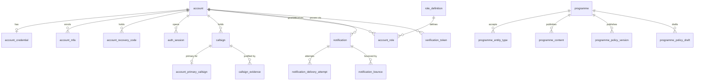
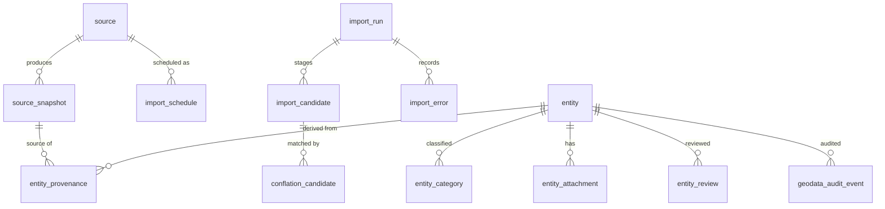
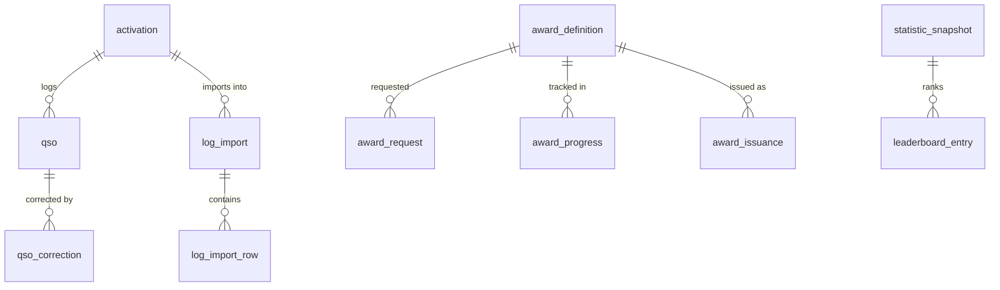

# Data model

Three databases, one owner each. This document is the authoritative schema
inventory for `myota-new`. It differs from the legacy schema in one important
way: **each table has exactly one owning service, and no table is duplicated
across databases.**

One ERD per database. They are separate diagrams because they are separate
databases: Mermaid cannot draw a relationship across them, and no such
relationship exists.

## Conventions

- Each **domain** table has exactly one owning service, and no domain table is
  duplicated across databases. The `ops` schema is the deliberate exception: the
  same operational tables exist in all three databases because they must be
  written in the owning database's transaction. They hold different rows, never
  shared data.
- Primary keys are `uuid` generated by the application (`gen_random_uuid()` in
  defaults for seed/testing only).
- Every table carries `created_at timestamptz not null default now()` and
  `updated_at timestamptz not null default now()`; `updated_at` is maintained by
  trigger, not by application code.
- Soft deletion is not used. Lifecycle is an explicit `status` column with a
  named state machine; rows are physically deleted only by retention jobs.
- Cross-database references are opaque `uuid` columns **without** foreign keys.
  They are documented as `→ ext:<service>`.
- When the referenced aggregate is closed in its owning service, the row is kept
  and marked `detached_at timestamptz` rather than deleted. History — a QSO logged
  against a retired place, an activation by a closed account — must survive the
  other service's lifecycle.
- Every database has the same operational schema in `ops`. There is no message
  broker, so the log and the queue are here:

### `ops` — present in all three databases

| Table | Purpose | Key columns |
| --- | --- | --- |
| `ops.outbox_event` | The event log. Written in the domain transaction. | `seq bigserial`, `id uuid unique`, `type`, `subject`, `partition`, `payload jsonb`, `created_at`, `published_at` |
| `ops.outbox_partition` | The relay's lease and published high-water mark, one row per partition. Up to `PARTITIONS` relays publish concurrently, each owning different partitions. | `partition`, `lease_owner`, `lease_until`, `last_seq`, `updated_at` |
| `ops.event_ack` | Consumers report their position so the producer can trim safely. | `consumer`, `source`, `last_acked_seq`, `reported_at` |
| `ops.consumer_checkpoint` | This service's read position in a **producer's** log. | `consumer`, `source`, `partition`, `last_seq`, `lease_owner`, `lease_until` |
| `ops.job` | Work with competing consumers. | `id uuid`, `kind`, `payload jsonb`, `state`, `attempt`, `lease_until`, `available_at`, `scheduled_for` |
| `ops.idempotency_record` | Request-level idempotency for mutating API calls. | `scope`, `key`, `request_hash`, `response jsonb`, `expires_at` |
| `ops.dead_letter` | Terminal failures for both jobs and events. | `id`, `source_table`, `ref_id`, `reason`, `payload jsonb` |

Indexes that matter:

```sql
CREATE INDEX ON ops.job (state, available_at) WHERE state = 'queued';
CREATE UNIQUE INDEX ON ops.job (kind, scheduled_for) WHERE scheduled_for IS NOT NULL;
CREATE INDEX ON ops.outbox_event (partition, seq);
CREATE INDEX ON ops.outbox_event (created_at);
```

`ops.outbox_event.seq` is monotonic per database but **not contiguous** — retention
trims rows, so consumers treat it as a cursor and never as a count.

`ops.outbox_partition.last_seq` is why the feed can be read safely. A `bigserial` is
allocated at INSERT time, not at COMMIT time, so two concurrent transactions can commit
out of sequence order. The relay publishes in ascending `seq` order under a lease and
never moves a partition's `last_seq` past a row it has not published, so a consumer that
stops at the first gap is correct: below the mark a gap is a trimmed row that was already
acknowledged, above it the row is simply not published yet. See
[messaging.md](messaging.md) and ADR-0004.

## `myota_core` — owned by `core`



Identity, authorization, programme configuration, and the notification ledger.
This is the only database the gateway may ask `core` about.

### Accounts and credentials

| Table | Key columns | Notes |
| --- | --- | --- |
| `account` | `id`, `display_name`, `email citext`, `participation_type`, `status`, `email_verified`, `insertion_order`, `suspended_at`, `suspension_reason` | Root subject. `participation_type ∈ (OPERATOR, SWL)`. `status ∈ (pending, active, closed)` — a registered but unverified account is `pending` and cannot log in; it is swept after 7 days so a mistyped address does not permanently block the real owner. |
| `account_credential` | `account_id` PK/FK, `password_hash`, `password_changed_at`, `failed_attempts`, `locked_until` | Password optional (credential-less accounts). Check: hash and timestamp are both null or both set. |
| `account_mfa` | `account_id`, `method`, `secret_ref`, `confirmed_at`, `last_used_at` | PK `(account_id, method)`. `method ∈ (totp, webauthn)`. At least one confirmed row is required for an account holding an admin role. |
| `account_recovery_code` | `id`, `account_id`, `code_hash`, `used_at` | Single-use MFA recovery codes. Separate table because there are several per account, unlike `account_mfa`. |
| `verification_token` | `token_hash` PK, `account_id` FK, `purpose`, `email citext`, `expires_at`, `used_at`, `issued_ip inet` | **One table for all four email flows.** `purpose ∈ (verify_email, reset_password, change_email)`. The raw token is never stored — only its SHA-256. `purpose` and `email` are both re-checked on use, so a token cannot be reinterpreted or used against a changed address. Issuing invalidates prior tokens for the same `(account_id, purpose)`. See [email-flows.md](email-flows.md). |
| `auth_session` | `id`, `account_id`, `audience`, `refresh_token_hash`, `access_jti`, `expires_at`, `revoked_at`, `user_agent`, `remote_addr`, `fresh_until` | **`audience ∈ (participant, admin)`** — the column that keeps the two logins separate. `fresh_until` records the last proof that the session's holder is the person who signed in; a role change, MFA reset or suspension requires it within five minutes. Bound to the session, so a stolen token cannot carry it. |
| `auth_revocation` | `jti` PK, `expires_at`, `revoked_at` | Denylist for access tokens. |
| `mfa_challenge` | `id`, `account_id`, `purpose`, `attempts`, `consumed_at`, `expires_at` | A sign-in waiting for a second factor. **Single-use**: answering consumes the row inside the same statement that checks it, so two concurrent answers make one session. `attempts` burns the challenge after five wrong codes. `purpose ∈ (admin_login)`. |
| `login_rate_limit` | `key_hash` PK, `window_started_at`, `request_count` | Per-account lockout. Not the same thing as edge rate limiting (Traefik): this counter must be global and authoritative, so it lives in the database. |
| `security_event` | `id`, `account_id`, `event_type`, `payload jsonb`, `occurred_at` | Append-only audit of auth events. |

### Callsigns and roles

| Table | Key columns | Notes |
| --- | --- | --- |
| `callsign` | `id`, `account_id`, `value`, `lifecycle_status`, `verified_at`, `valid_from`, `valid_to` | `status ∈ (UNVERIFIED, VERIFIED, RETIRED)`. Unique `(account_id, value)`. |
| `callsign_evidence` | `id`, `callsign_id`, `evidence_type`, `source`, `checksum`, `metadata jsonb`, `status` | |
| `account_primary_callsign` | `account_id` PK, `callsign_id` UNIQUE | One primary per account; a callsign can be primary for at most one account. |
| `role_definition` | `role_code` PK, `display_name`, `scopes text[]`, `is_system` | Catalogue of roles. |
| `account_role` | `id`, `account_id` FK, `role_code` FK, `programme_id` FK, `jurisdiction_code`, `entity_type_code`, `scopes jsonb`, `valid_to` | Scoped grant. Partial index on open roles. |
| `approver_scope` | `id`, `programme_id`, `entity_type_code`, `account_id` | Who may approve geodata in a scope. |

### Programmes

| Table | Key columns | Notes |
| --- | --- | --- |
| `programme` | `id`, `slug` UNIQUE, `name`, `status`, `default_entity_type` | `status ∈ (draft, active, archived)`. |
| `programme_entity_type` | `programme_id`, `category_code`, `label`, `geometry_policy jsonb` | Which categories a programme accepts. |
| `programme_content` | `id`, `programme_id`, `kind`, `locale`, `body_markdown`, `status`, `published_at` | Public content pages. |
| `programme_policy_version` | `id`, `programme_id`, `version`, `rules jsonb`, `published_at` | Immutable once published. |
| `programme_policy_draft` | `id`, `programme_id`, `version`, `rules jsonb`, `status`, `reviewer_id` | `status ∈ (draft, in_review, approved, rejected)`. |
| `jurisdiction` | `id`, `code`, `name`, `parent_id` | Administrative geography used for role scoping — **not** the spatial catalogue. |

### Notifications — one ledger

| Table | Key columns | Notes |
| --- | --- | --- |
| `notification` | `id`, `account_id` FK, `template`, `channel`, `payload jsonb`, `status`, `attempts`, `provider_id`, `failure_reason`, `created_at`, `sent_at` | `status ∈ (queued, sending, delivered, failed, dead, suppressed)`. `template` is an **allowlisted id** (`account-verify.v1`), never caller-supplied body text — otherwise the notification system is an open relay. `provider_id` is the SMTP message id, used to correlate bounces. `channel ∈ (email, in_app)`. |
| `notification_delivery_attempt` | `id`, `notification_id`, `attempt`, `outcome`, `provider_response`, `attempted_at` | `outcome ∈ (accepted, transient_failure, permanent_failure)`. Bounded at 8 attempts, then `status = dead`. |
| `notification_bounce` | `id`, `notification_id`, `type`, `code`, `diagnostic`, `received_at` | From the provider webhook. `type ∈ (hard, soft, complaint)`. A hard bounce marks the address undeliverable and suppresses further mail without closing the account. |
| `email_suppression` | `email citext` PK, `reason`, `created_at`, `released_at` | Addresses that must not receive mail: hard-bounced, complained, or manually suppressed. Keyed by address, **not** by notification — the worker checks it before sending, so there is no foreign key and the table survives an account being deleted. Exposed in the admin console so an operator can see how many accounts are unreachable. |

The legacy system had `email_delivery`, `email_delivery_attempt`,
`email_dead_letter`, `email_dead_letter_redrive`, plus `activity_notification`
and `activity_notification_redrive` — six tables for one responsibility, in two
databases. Here it is one ledger plus one attempt table plus the shared
`ops.dead_letter`.

## `myota_geo` — owned by `geodata`



The spatial catalogue. The only database with `postgis`.

### Entities

| Table | Key columns | Notes |
| --- | --- | --- |
| `entity` | `id`, `programme_id → ext:core`, `entity_type_code`, `name`, `slug`, `status`, `geom geometry(Geometry,4326)`, `centroid geometry(Point,4326)`, `bbox geometry(Polygon,4326)`, `revision` | GiST index on `geom` and `centroid`. `status ∈ (draft, in_review, published, retired)`. |
| `entity_category` | `entity_id`, `category_code`, `is_primary` | `entity_id` is a real FK to `entity`. `category_code` is an opaque text code validated against `core.programme_entity_type` through the API — **not** a foreign key. |
| `entity_attachment` | `id`, `entity_id`, `kind`, `object_key`, `media_type`, `checksum` | Images held in S3. |
| `entity_review` | `id`, `entity_id`, `reviewer_id → ext:core`, `decision`, `notes`, `decided_at` | `decision ∈ (approve, reject, needs_info)`. |

### Provenance

| Table | Key columns | Notes |
| --- | --- | --- |
| `source` | `id`, `name`, `adapter`, `default_format`, `licence`, `attribution`, `homepage` | A data provider. `adapter ∈ (PARKSERVE_US, OSM, GOVERNMENT_GIS, MANUAL)`; `default_format ∈ (geojson, wfs_geojson, arcgis, kml, gpx, shapefile_zip, osm_pbf, csv_wkt)`. |
| `source_snapshot` | `id`, `source_id`, `checksum`, `object_key`, `feature_count`, `retrieved_at` | The exact bytes an import read. |
| `entity_provenance` | `entity_id`, `snapshot_id`, `source_feature_id`, `confidence numeric` | Where a published entity came from. |

### Imports

| Table | Key columns | Notes |
| --- | --- | --- |
| `import_run` | `id`, `source_id`, `programme_id`, `snapshot_id`, `stage`, `status`, `counts jsonb`, `started_at`, `finished_at` | `stage ∈ (upload, normalise, validate, conflate, publish)`; awaiting an administrator is `status='review'`, not a stage. |
| `import_candidate` | `id`, `run_id`, `source_feature_id`, `payload jsonb`, `geom geometry(Geometry,4326)`, `state`, `reject_reason` | `state ∈ (pending, valid, invalid, duplicate, promoted, rejected)`. |
| `import_error` | `id`, `run_id`, `candidate_id`, `severity`, `code`, `message` | |
| `conflation_candidate` | `id`, `run_id`, `candidate_id`, `entity_id`, `score numeric`, `reason jsonb`, `resolution` | `resolution ∈ (new, merge, skip, unresolved)`. |
| `upload_session` | `id`, `object_key`, `size`, `checksum`, `state`, `expires_at` | Multipart resumable upload. |
| `upload_part` | `session_id`, `part_number`, `etag`, `size` | |
| `import_schedule` | `id`, `source_id`, `cron`, `enabled`, `last_run_at` | Replaces ad-hoc refresh scripts. |

### Audit

| Table | Key columns |
| --- | --- |
| `geodata_audit_event` | `id`, `entity_id`, `actor_id → ext:core`, `action`, `before jsonb`, `after jsonb`, `occurred_at` |

## `myota_activity` — owned by `activity`



Activations, logs, awards, statistics. No spatial columns — `activity` stores
`entity_id` and asks `geodata` for geometry through its API when it needs it, or
reads the denormalised name/elevation captured at activation start.

### Activations and QSOs

| Table | Key columns | Notes |
| --- | --- | --- |
| `activation` | `id`, `account_id → ext:core`, `callsign`, `entity_id → ext:geodata`, `entity_name`, `entity_elevation_m`, `programme_id → ext:core`, `started_at`, `ended_at`, `status`, `qso_count`, `points` | `status ∈ (active, closed, cancelled)`. `entity_name` and `entity_elevation_m` are captured at start so a later rename in `geodata` does not rewrite history. |
| `qso` | `id`, `activation_id`, `worked_callsign`, `band`, `mode`, `rst_sent`, `rst_received`, `worked_at`, `points`, `source` | `source ∈ (live, adif, csv)`. |
| `qso_correction` | `id`, `qso_id`, `requested_by → ext:core`, `changes jsonb`, `status`, `reviewed_by` | |
| `log_import` | `id`, `activation_id`, `format`, `object_key`, `accepted`, `rejected`, `status` | ADIF/CSV file import. |
| `log_import_row` | `id`, `import_id`, `line_number`, `outcome`, `message` | |

### Awards

| Table | Key columns | Notes |
| --- | --- | --- |
| `award_definition` | `id`, `programme_id`, `code`, `name`, `rules jsonb`, `status`, `version` | `rules` is the condition tree. |
| `award_request` | `id`, `award_id`, `account_id → ext:core`, `status`, `submitted_at`, `decided_at` | |
| `award_progress` | `award_id`, `account_id`, `satisfied`, `progress jsonb`, `evaluated_at` | Materialised evaluation. |
| `award_issuance` | `id`, `award_id`, `account_id`, `issued_at`, `certificate_key` | Certificate held in S3. |

### Statistics

| Table | Key columns | Notes |
| --- | --- | --- |
| `statistic_snapshot` | `id`, `scope`, `scope_id`, `period`, `payload jsonb`, `built_at` | `scope ∈ (account, programme, entity)`. |
| `leaderboard_entry` | `snapshot_id`, `rank`, `account_id`, `value` | |

## Cross-database references at a glance

```
account_id      core.account.id      → activity, geodata
programme_id    core.programme.id    → geodata, activity
entity_id       geo.entity.id        → activity
jurisdiction    core.jurisdiction    (core only — not spatial)
```

No foreign keys cross these lines. An account deleted in `core` produces
`core.account.closed.v1`; `activity` and `geodata` mark their copies as
`detached` and retain the rows for audit. Referential integrity is a property of
the event stream, not of Postgres.

## What was removed

| Removed | Why |
| --- | --- |
| `myota_core.activation`, `.qso`, `.award`, `.award_rule` | Legacy monolith tables that survived the baseline migration and were never dropped. Activity owns these now. |
| `myota_core.jurisdiction` as spatial data | Kept only as administrative codes for role scoping; geometry lives in `geodata`. |
| `service_state` JSONB archive | Was a Python-era serialisation dump. Superseded by real tables. |
| `identity_casefold_mapping` (1 530 rows of Unicode table) | Replaced by `citext` + a normalised `email_key` column. |
| `identity_auth_state_migration` | One-off backfill marker from the Python migration; not needed in a fresh schema. |
| `geodata_edit_staging`, `geodata_control_record`, `geodata_schema_feature` | Three overlapping staging mechanisms; replaced by `import_candidate`. |
| `source_snapshot_manifest` + `source_snapshot_record` | Collapsed into `source_snapshot` with a `feature_count`. |
| `import_processing_queue` | Queue state belongs in `ops.job`, not a domain table. |
| `entity_type` (geo) | Duplicated `core.programme_entity_type`. Programmes own their categories. |

## Sizing

Rough order of magnitude, based on the legacy production data:

| Database | Rows (growth driver) | Notes |
| --- | --- | --- |
| `myota_core` | 10⁴ accounts, 10⁵ sessions | Small, latency-critical. |
| `myota_geo` | 10⁶ entities, 10⁷ candidates transient | Largest by bytes; PostGIS dominant. |
| `myota_activity` | 10⁷ QSOs | Largest by rows; append-heavy. Partition `qso` by `worked_at` year when it passes 10⁷. |

## Migration strategy

A fresh schema, not an in-place migration. The legacy databases are archived
with the repositories; there is no requirement to preserve their data (the
decommission explicitly discarded it). The baseline migration creates the schema
above; subsequent migrations are append-only and numbered from `001`.
