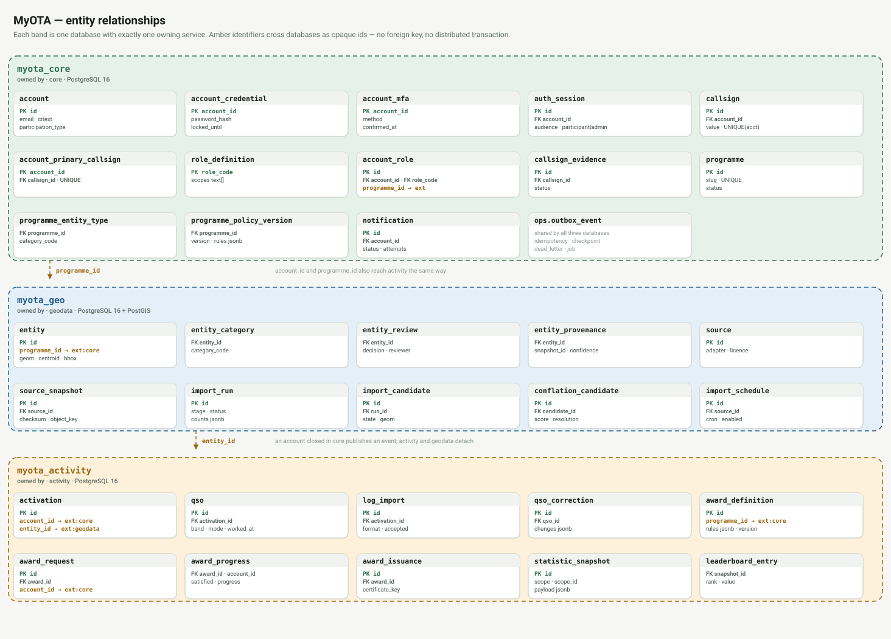

# Data model

Three databases, one owner each. This document is the authoritative schema
inventory for `myota-new`. It differs from the legacy schema in one important
way: **each table has exactly one owning service, and no table is duplicated
across databases.**



## Conventions

- Primary keys are `uuid` generated by the application (`gen_random_uuid()` in
  defaults for seed/testing only).
- Every table carries `created_at timestamptz not null default now()` and
  `updated_at timestamptz not null default now()`; `updated_at` is maintained by
  trigger, not by application code.
- Soft deletion is not used. Lifecycle is an explicit `status` column with a
  named state machine; rows are physically deleted only by retention jobs.
- Cross-database references are opaque `uuid` columns **without** foreign keys.
  They are documented as `→ ext:<service>`.
- Every database has the same operational schema in `ops`:
  `ops.outbox_event`, `ops.idempotency_record`, `ops.consumer_checkpoint`,
  `ops.dead_letter`, `ops.job`.

## `myota_core` — owned by `core`

Identity, authorization, programme configuration, and the notification ledger.
This is the only database the gateway may ask `core` about.

### Accounts and credentials

| Table | Key columns | Notes |
| --- | --- | --- |
| `account` | `id`, `display_name`, `email citext`, `participation_type`, `status`, `insertion_order` | Root subject. `participation_type ∈ (OPERATOR, SWL)`. |
| `account_credential` | `account_id` PK/FK, `password_hash`, `password_changed_at`, `failed_attempts`, `locked_until` | Password optional (credential-less accounts). Check: hash and timestamp are both null or both set. |
| `account_mfa` | `account_id`, `method`, `secret_ref`, `confirmed_at`, `last_used_at` | `method ∈ (totp, webauthn)`. Required for admin roles. |
| `account_recovery_token` | `token_hash` PK, `account_id`, `expires_at`, `used_at` | Single-use, hashed at rest. |
| `email_verification_token` | `token_hash` PK, `account_id`, `expires_at`, `used_at` | |
| `auth_session` | `id`, `account_id`, `audience`, `refresh_token_hash`, `access_jti`, `expires_at`, `revoked_at`, `user_agent`, `remote_addr` | **`audience ∈ (participant, admin)`** — the column that keeps the two logins separate. |
| `auth_revocation` | `jti` PK, `expires_at`, `revoked_at` | Denylist for access tokens. |
| `login_rate_limit` | `key_hash` PK, `window_started_at`, `request_count` | |
| `security_event` | `id`, `account_id`, `event_type`, `payload jsonb`, `occurred_at` | Append-only audit of auth events. |

### Callsigns and roles

| Table | Key columns | Notes |
| --- | --- | --- |
| `callsign` | `id`, `account_id`, `value`, `lifecycle_status`, `verified_at`, `valid_from`, `valid_to` | `status ∈ (UNVERIFIED, VERIFIED, RETIRED)`. Unique `(account_id, value)`. |
| `callsign_evidence` | `id`, `callsign_id`, `evidence_type`, `source`, `checksum`, `metadata jsonb`, `status` | |
| `account_primary_callsign` | `account_id` PK, `callsign_id` UNIQUE | One primary per account; a callsign can be primary for at most one account. |
| `role_definition` | `role_code` PK, `display_name`, `scopes text[]`, `is_system` | Catalogue of roles. |
| `account_role` | `id`, `account_id`, `role_code`, `programme_id → ext:self`, `jurisdiction_code`, `entity_type_code`, `scopes jsonb`, `valid_to` | Scoped grant. Partial index on open roles. |
| `approver_scope` | `id`, `programme_id`, `entity_type_code`, `account_id` | Who may approve geodata in a scope. |

### Programmes

| Table | Key columns | Notes |
| --- | --- | --- |
| `programme` | `id`, `slug` UNIQUE, `name`, `status`, `default_entity_type` | `status ∈ (draft, active, archived)`. |
| `programme_entity_type` | `programme_id`, `category_code`, `label`, `geometry_policy jsonb` | Which categories a programme accepts. |
| `programme_content` | `id`, `programme_id`, `kind`, `locale`, `body_markdown`, `status`, `published_at` | Public content pages. |
| `programme_policy_version` | `id`, `programme_id`, `version`, `rules jsonb`, `published_at` | Immutable once published. |
| `programme_policy_draft` | `id`, `programme_id`, `version`, `rules jsonb`, `status`, `reviewer_id` | `status ∈ (draft, in_review, approved, rejected)`. |
| `jurisdiction` | `id`, `code`, `name`, `parent_id` | Administrative geography used for role scoping — **not** the spatial catalogue. |

### Notifications — one ledger

| Table | Key columns | Notes |
| --- | --- | --- |
| `notification` | `id`, `account_id → ext:self`, `template`, `payload jsonb`, `channel`, `status`, `attempts`, `sent_at` | `status ∈ (queued, sent, failed, dead)`. |
| `notification_delivery_attempt` | `id`, `notification_id`, `attempt`, `outcome`, `provider_response` | |

The legacy system had `email_delivery`, `email_delivery_attempt`,
`email_dead_letter`, `email_dead_letter_redrive`, plus `activity_notification`
and `activity_notification_redrive` — five tables for one responsibility, in two
databases. Here it is one ledger plus one attempt table plus the shared
`ops.dead_letter`.

## `myota_geo` — owned by `geodata`

The spatial catalogue. The only database with `postgis`.

### Entities

| Table | Key columns | Notes |
| --- | --- | --- |
| `entity` | `id`, `programme_id → ext:core`, `entity_type_code`, `name`, `slug`, `status`, `geom geometry(Geometry,4326)`, `centroid geometry(Point,4326)`, `bbox geometry(Polygon,4326)`, `revision` | GiST index on `geom` and `centroid`. `status ∈ (draft, in_review, published, retired)`. |
| `entity_category` | `entity_id`, `category_code`, `is_primary` | Many-to-many with `programme_entity_type`. |
| `entity_attachment` | `id`, `entity_id`, `kind`, `object_key`, `media_type`, `checksum` | Images held in S3. |
| `entity_review` | `id`, `entity_id`, `reviewer_id → ext:core`, `decision`, `notes`, `decided_at` | `decision ∈ (approve, reject, needs_info)`. |

### Provenance

| Table | Key columns | Notes |
| --- | --- | --- |
| `source` | `id`, `name`, `adapter`, `licence`, `attribution`, `homepage` | A data provider. `adapter ∈ (geojson, shapefile, gpx, osm_pbf, csv_wkt)`. |
| `source_snapshot` | `id`, `source_id`, `checksum`, `object_key`, `feature_count`, `retrieved_at` | The exact bytes an import read. |
| `entity_provenance` | `entity_id`, `snapshot_id`, `source_feature_id`, `confidence numeric` | Where a published entity came from. |

### Imports

| Table | Key columns | Notes |
| --- | --- | --- |
| `import_run` | `id`, `source_id`, `programme_id`, `snapshot_id`, `stage`, `status`, `counts jsonb`, `started_at`, `finished_at` | `stage ∈ (upload, normalise, validate, conflate, review, publish)`. |
| `import_candidate` | `id`, `run_id`, `source_feature_id`, `payload jsonb`, `geom geometry(Geometry,4326)`, `state`, `reject_reason` | `state ∈ (pending, valid, invalid, duplicate, promoted, rejected)`. |
| `import_error` | `id`, `run_id`, `candidate_id`, `severity`, `code`, `message` | |
| `conflation_candidate` | `id`, `run_id`, `candidate_id`, `entity_id`, `score numeric`, `reason jsonb`, `resolution` | `resolution ∈ (new, merge, skip, unresolved)`. |
| `upload_session` | `id`, `object_key`, `size`, `checksum`, `state`, `expires_at` | Multipart resumable upload. |
| `upload_part` | `session_id`, `part_number`, `etag`, `size` | |
| `import_schedule` | `id`, `source_id`, `cron`, `enabled`, `last_run_at` | Replaces ad-hoc refresh scripts. |

### Audit

| Table | Key columns |
| --- | --- |
| `geodata_audit_event` | `id`, `entity_id`, `actor_id → ext:core`, `action`, `before jsonb`, `after jsonb`, `occurred_at` |

## `myota_activity` — owned by `activity`

Activations, logs, awards, statistics. No spatial columns — `activity` stores
`entity_id` and asks `geodata` for geometry through its API when it needs it, or
reads the denormalised name/elevation captured at activation start.

### Activations and QSOs

| Table | Key columns | Notes |
| --- | --- | --- |
| `activation` | `id`, `account_id → ext:core`, `callsign`, `entity_id → ext:geodata`, `programme_id → ext:core`, `started_at`, `ended_at`, `status`, `qso_count`, `points` | `status ∈ (active, closed, cancelled)`. |
| `qso` | `id`, `activation_id`, `worked_callsign`, `band`, `mode`, `rst_sent`, `rst_received`, `worked_at`, `points`, `source` | `source ∈ (live, adif, csv)`. |
| `qso_correction` | `id`, `qso_id`, `requested_by → ext:core`, `changes jsonb`, `status`, `reviewed_by` | |
| `log_import` | `id`, `activation_id`, `format`, `object_key`, `accepted`, `rejected`, `status` | ADIF/CSV file import. |
| `log_import_row` | `id`, `import_id`, `line_number`, `outcome`, `message` | |

### Awards

| Table | Key columns | Notes |
| --- | --- | --- |
| `award_definition` | `id`, `programme_id`, `code`, `name`, `rules jsonb`, `status`, `version` | `rules` is the condition tree. |
| `award_request` | `id`, `award_id`, `account_id → ext:core`, `status`, `submitted_at`, `decided_at` | |
| `award_progress` | `award_id`, `account_id`, `satisfied`, `progress jsonb`, `evaluated_at` | Materialised evaluation. |
| `award_issuance` | `id`, `award_id`, `account_id`, `issued_at`, `certificate_key` | Certificate held in S3. |

### Statistics

| Table | Key columns | Notes |
| --- | --- | --- |
| `statistic_snapshot` | `id`, `scope`, `scope_id`, `period`, `payload jsonb`, `built_at` | `scope ∈ (account, programme, entity)`. |
| `leaderboard_entry` | `snapshot_id`, `rank`, `account_id`, `value` | |

## Cross-database references at a glance

```
account_id      core.account.id      → activity, geodata
programme_id    core.programme.id    → geodata, activity
entity_id       geo.entity.id        → activity
jurisdiction    core.jurisdiction    (core only — not spatial)
```

No foreign keys cross these lines. An account deleted in `core` produces
`core.account.closed.v1`; `activity` and `geodata` mark their copies as
`detached` and retain the rows for audit. Referential integrity is a property of
the event stream, not of Postgres.

## What was removed

| Removed | Why |
| --- | --- |
| `myota_core.activation`, `.qso`, `.award`, `.award_rule` | Legacy monolith tables that survived the baseline migration and were never dropped. Activity owns these now. |
| `myota_core.jurisdiction` as spatial data | Kept only as administrative codes for role scoping; geometry lives in `geodata`. |
| `service_state` JSONB archive | Was a Python-era serialisation dump. Superseded by real tables. |
| `identity_casefold_mapping` (1 540 rows of Unicode table) | Replaced by `citext` + a normalised `email_key` column. |
| `identity_auth_state_migration` | One-off backfill marker from the Python migration; not needed in a fresh schema. |
| `geodata_edit_staging`, `geodata_control_record`, `geodata_schema_feature` | Three overlapping staging mechanisms; replaced by `import_candidate`. |
| `source_snapshot_manifest` + `source_snapshot_record` | Collapsed into `source_snapshot` with a `feature_count`. |
| `import_processing_queue` | Queue state belongs in `ops.job`, not a domain table. |
| `entity_type` (geo) | Duplicated `core.programme_entity_type`. Programmes own their categories. |

## Sizing

Rough order of magnitude, based on the legacy production data:

| Database | Rows (growth driver) | Notes |
| --- | --- | --- |
| `myota_core` | 10⁴ accounts, 10⁵ sessions | Small, latency-critical. |
| `myota_geo` | 10⁶ entities, 10⁷ candidates transient | Largest by bytes; PostGIS dominant. |
| `myota_activity` | 10⁷ QSOs | Largest by rows; append-heavy. Partition `qso` by `worked_at` year when it passes 10⁷. |

## Migration strategy

A fresh schema, not an in-place migration. The legacy databases are archived
with the repositories; there is no requirement to preserve their data (the
decommission explicitly discarded it). The baseline migration creates the schema
above; subsequent migrations are append-only and numbered from `001`.
