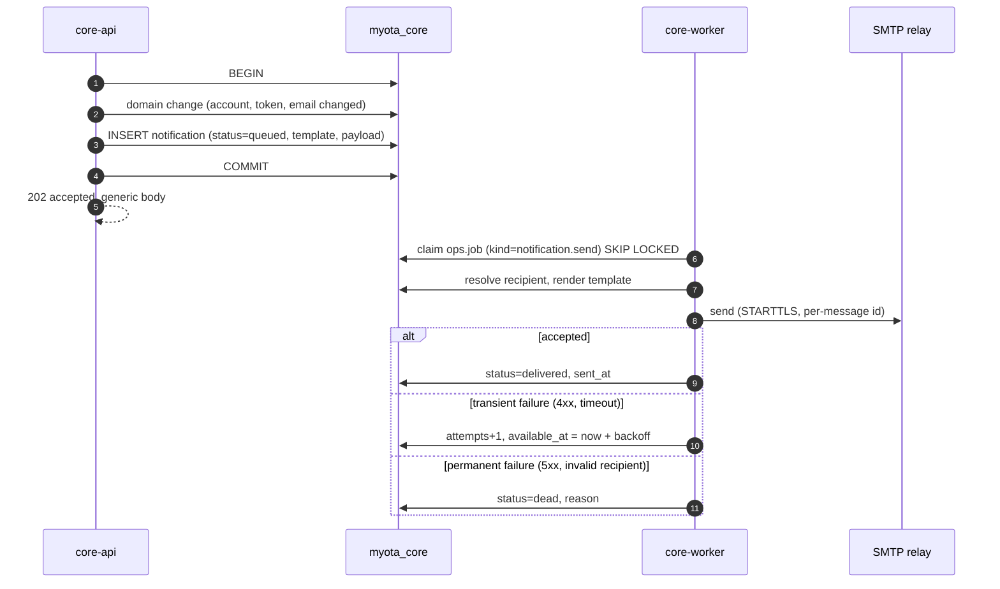

# Email flows

Registration, activation, password recovery, and email change. These are the
flows an account depends on before it can do anything else, and the ones where a
mistake is either a lockout or an account takeover.

Everything here is owned by `core`. There is one notification ledger, one delivery
pipeline, and one SMTP credential — see
[secrets-and-config.md](secrets-and-config.md).

## The four flows

| Flow | Trigger | Token | Lifetime | Ends with |
| --- | --- | --- | --- | --- |
| **Registration** | `POST /v1/auth/register` | verification | 24 h | account activated |
| **Password recovery** | `POST /v1/auth/recovery/request` | reset | 30 min | password changed, sessions revoked |
| **Email change** | `POST /v1/me/email/change` | confirm (sent to new address) | 2 h | address changed, both parties notified |
| **Email reverification** | bounces or admin edit | verification | 24 h | address re-confirmed |

All four use the same primitive: a single-use, hashed, expiring token bound to one
account and one purpose.

## Delivery pipeline

Email is not sent inline. The HTTP handler writes a delivery row in the same
transaction as the domain change, and a worker sends it.



Why this shape and not a direct `smtp.send()` in the request handler:

- **The token and the email commit together.** If the send fails, the token still
  exists and a resend works. If the transaction rolls back, no email goes out for
  an account that was never created.
- **A slow SMTP server does not hold an HTTP request open**, and does not consume
  a database connection while waiting.
- **Retries are bounded and observable.** The legacy worker exhausted at 8
  attempts and moved to `DEAD_LETTER`; the status column is the audit trail.

| Concern | Value |
| --- | --- |
| Attempts before dead | 8 |
| Backoff | 30 s, 2 m, 10 m, 30 m, 2 h, 6 h, 12 h |
| Per-message timeout | 10 s |
| Worker concurrency | 4 per replica (SMTP is the bottleneck, not CPU) |

## Tokens

One table, one purpose per row. A token is never reused across flows, because a
verification token that could reset a password would make every leaked welcome
email an account takeover.

```
verification_token
  token_hash    text PK      SHA-256 of the raw token, never the token itself
  account_id    uuid FK
  purpose       text         verify_email | reset_password | change_email
  email         citext       the address this token was issued for
  expires_at    timestamptz
  used_at       timestamptz
  issued_ip     inet
```

Rules that make it safe:

- **The raw token exists only in the email.** The database holds a hash. A dump of
  `myota_core` does not let anyone reset a password.
- **`purpose` is checked on use.** A `verify_email` token presented to the reset
  endpoint is rejected — not downgraded, not reinterpreted.
- **`email` is checked on use.** If the address changed after the token was
  issued, the token no longer applies. This is what stops an attacker who
  controls the old address from taking over after a change.
- **Single use.** `used_at` is set in the same transaction that performs the
  action, with `WHERE used_at IS NULL` so a race cannot redeem twice.
- **Issuing invalidates prior tokens** for the same `(account_id, purpose)`, so a
  resend does not leave a second live link.
- **256 bits of entropy**, URL-safe base64, from a CSPRNG.

The link shape:

```
https://app.myota.example/v1/auth/verify?t=<token>
```

The token is in the query string because it is clicked from a mail client. It is
never logged: the access log records the path only, and the referrer policy is
`no-referrer` so it does not leak to third parties.

## Registration and activation

```
POST /v1/auth/register      { email, displayName, password, participationType }
  → 202 { message: "Check your inbox to finish setting up your account." }

GET  /v1/auth/verify?t=…    → 303 to the participant app, session issued
POST /v1/auth/register/resend  { email }
  → 202, same body whether or not the address is known
```

The account is created immediately but is **not usable** until verified.

| State | `account.status` | Can log in |
| --- | --- | --- |
| Registered, unverified | `pending` | no |
| Verified | `active` | yes |
| Closed | `closed` | no |

Rules:

- **Login on an unverified account returns `403` with `type=…#email-unverified`,
  not `401`.** The response is deliberately distinguishable, because a user who
  cannot log in needs to know to check their mail. This trades a small amount of
  enumeration surface for a large amount of support load, and the enumeration is
  already available from the registration endpoint's behaviour.
- **Resend is rate limited to 3 per hour per account** and 5 per hour per IP, and
  always returns the same body. It does not reveal whether the address exists.
- **An unverified account is swept after 7 days.** The address is released, so
  someone who mistyped their address is not permanently blocked from registering.

### Why verification is required at all

It is the only proof that the person registering controls the address. Without it,
anyone can register with someone else's address, and every notification — including
a later password reset — goes to a stranger.

## Password recovery

```
POST /v1/auth/recovery/request  { email }
  → 202 { message: "If that address has an account, a link is on its way." }

POST /v1/auth/recovery/reset    { token, newPassword }
  → 204
```

**Request is always identical in body, status, and timing** whether or not the
address exists. The timing part is real work: the handler performs the token
insert and mail enqueue on a miss too, into a discard path, so the fast path is not
detectably faster. Without that, an attacker enumerates accounts with a
stopwatch.

| Property | Value |
| --- | --- |
| Token lifetime | 30 min |
| Rate limit | 3 per hour per address, 5 per hour per IP |
| On success | password changed, **all sessions revoked** except none — every session dies |
| Reuse | single use; issuing invalidates prior reset tokens |

Revoking every session is deliberate. A password reset usually means the password
was compromised or forgotten; leaving an attacker's existing session alive defeats
the point. The user re-authenticates, which is one extra step and the correct
default.

Changing a password from a *logged-in* session is a different operation —
`PUT /v1/me/password` — which requires the current password and revokes all
sessions except the current one. Two flows, two threat models.

## Email change

The legacy implementation had no email-change flow. That was a gap, not a
simplification: without it, a participant whose address changes has to abandon
their account and their activation history.

**Changing an address requires confirming both sides.** Two tokens, two emails,
one transaction.

```
POST /v1/me/email/change   { newEmail, currentPassword }
  → 202

  Email A (to the OLD address): "Your address is being changed to n•••@example.com.
                                 If this was not you, click here to cancel."
  Email B (to the NEW address): "Confirm this address. <link>"

POST /v1/me/email/confirm  { token }
  → 204, address changed
```

Rules:

- **`currentPassword` is required.** Changing the address is an account-takeover
  primitive; knowing the new address is not authorization.
- **The old address is always notified**, immediately, with a one-click cancel. If
  the change was not requested by the owner, they learn about it while it is still
  reversible.
- **The change does not take effect until the new address confirms.** Until then
  the account keeps its old address and remains fully usable.
- **Confirming revokes the cancel window.** The old-address notice carries a token
  valid for the same 2 h; redeeming it after confirmation is rejected.
- **Rate limited to 1 request per 24 h per account**, which makes the flow useless
  for harassment of a third party's address.
- **The `email` column on any outstanding token is re-checked.** A reset token
  issued to the old address cannot be redeemed after the change lands.

An admin editing an address directly (support case) sets
`email_verified = false` and issues a verification email, rather than silently
marking it verified.

## Deliverability

The system sends password resets. If those land in spam, users cannot recover
accounts — this is an availability concern, not a nicety.

| Requirement | Value |
| --- | --- |
| Sender domain | dedicated subdomain, e.g. `mail.myota.example` |
| SPF | `v=spf1 include:<provider> -all` |
| DKIM | 2048-bit, rotated yearly, key published by the provider |
| DMARC | `p=quarantine` initially, `p=reject` once reports are clean |
| From address | `no-reply@mail.myota.example`, with a `Reply-To` that reaches a human |
| Bounce handling | provider webhook → `notification_bounce` → address marked `undeliverable` |

A hard bounce (5xx) marks the address undeliverable and suppresses further mail to
it, but does **not** close the account: the person may still log in. A soft bounce
is retried through the normal job backoff.

Suppressed addresses surface in the admin console, so an operator can see "14
accounts are unreachable" rather than discovering it from a support ticket.

## Templates

Templates live in `core`, versioned in code, and are referenced by id:

```
notification.template = 'participant-email-verification.v1'
```

| Template | Purpose |
| --- | --- |
| `account-verify.v1` | registration activation |
| `account-welcome.v1` | sent after verification succeeds |
| `password-reset.v1` | recovery link |
| `email-change-confirm.v1` | to the new address |
| `email-change-notice.v1` | to the old address, with a cancel link |
| `password-changed.v1` | security notice, no link |
| `account-closed.v1` | confirmation |

Rules:

- **A template is an allowlisted id, not a string from the request.** The caller
  supplies a template id and a payload; it cannot inject arbitrary body text.
  Otherwise the notification system is an open relay.
- **Payload values are escaped per channel.** The same template renders to email
  and (later) to in-app; escaping is the renderer's job, not the caller's.
- **Every template has a plain-text part.** Not a preference — a multipart
  alternative measurably improves deliverability.
- **No token in a template that is not a link template.** A security notice never
  contains a clickable action, so it cannot be used as a phishing template.
- **Version suffix on the id**, so a change is a new id and old queued messages
  still render with the template they were queued for.

## Notification ledger

One table for every message the platform sends, not just email.

```
notification
  id             uuid PK
  account_id     uuid FK
  template       text        allowlisted id
  channel        text        email | in_app
  payload        jsonb       template variables
  status         text        queued | sending | delivered | failed | dead | suppressed
  attempts       int
  provider_id    text        the SMTP/provider message id, for bounce correlation
  created_at     timestamptz
  sent_at        timestamptz
  failure_reason text
```

The legacy system had four email tables plus two activity-notification tables for
this. One ledger, one attempt counter, one dead state.

## Security properties, stated as tests

| Property | Test |
| --- | --- |
| Registration does not reveal whether an address exists | identical status, body and timing for new and existing addresses |
| Recovery request does not enumerate | as above, including a token row written on the miss path |
| A verification token cannot reset a password | present a `verify_email` token to `/recovery/reset`, expect 400 |
| A token cannot be redeemed twice | redeem, then redeem again, expect 400 |
| A token cannot be used from a different address | change email, then present the old reset token, expect 400 |
| Resend invalidates the previous link | request twice, use the first, expect 400 |
| Password reset kills sessions | log in on two devices, reset, assert both 401 |
| Email change needs the password | submit without `currentPassword`, expect 400 |
| Email change notifies the old address | assert an outbound `email-change-notice.v1` was queued |
| Old-address cancel works after confirmation is rejected | confirm, then redeem the cancel token, expect 400 |
| No token is logged | grep the access log fixture for the token, expect none |

## What is deliberately not here

- **No OIDC or social login.** Mentioned in the non-goals; a single provider hook
  exists but is disabled. It would add a second identity path with its own
  recovery story.
- **No SMS.** Not a recovery channel this platform will support: phone numbers
  are more expensive to verify than addresses and are worse for enumeration
  resistance.
- **No magic-link login.** A useful feature, but it makes every email a login
  credential, which changes the threat model of the whole notification system.
  Worth an ADR if it is ever wanted.
- **No in-app notification UI yet.** `channel = in_app` exists in the ledger so the
  data model does not need to change when it arrives.
