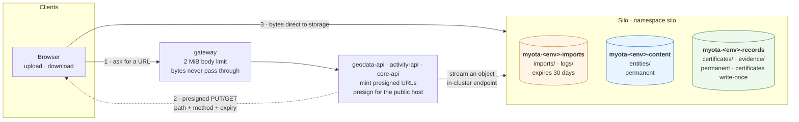

# Object storage

Files live in **Silo**, the S3-compatible store already running on this cluster.
This document names the buckets, fixes the key layout, and states what the service
credentials may and may not do.

Silo is a PGSTY fork of MinIO (`RELEASE.2026-10-26T00-00-00Z`) in namespace `silo`
on `spainip-k3s`, with one replica and a 100 GiB `local-path` claim. It is a shared
tenant store: `bminfo` and `spainip-loki` already live in it. That shapes the whole
design below — Myota is one tenant among several, holds no administrative access,
and must not be able to see or disturb anyone else's buckets.

## Three hostnames, and why it matters

```
in-cluster   http://silo.silo.svc.cluster.local:9000     the services talk here
public API   https://silo-api.spainip.es                  the browser talks here
console      https://silo.spainip.es                      a browser UI, never an S3 client
```

The console is listed because it is a trap rather than because it is part of the design.
It is a single-page app that answers **HTTP 200 with an HTML document for every path**,
including `PUT /<bucket>`. An S3 client pointed at it reads the 200 as success and the
HTML as malformed XML, so it reports buckets as created that were never created, and
reports that lifecycle is unsupported when it works. `tools/provision_silo.py` refuses the
console host outright and the generated script preflights the endpoint's content type.

Both real endpoints point at the same server. The distinction is not cosmetic: **a presigned URL
is signed over its `Host`.** Signing against the in-cluster address produces a URL
whose signature no browser can satisfy, because `silo.silo.svc.cluster.local` is a
ClusterIP that does not resolve outside the cluster.

So there are two configured endpoints, and they are used for different things:

| Use | Endpoint | Why |
| --- | --- | --- |
| Streaming an object to read it (worker, API) | in-cluster | stays on the cluster network, no ingress hop, no public exposure |
| Minting a presigned URL for a client | public | the browser must be able to reach it, and the signature covers the host |
| Health, `GetBucketLocation`, lifecycle | in-cluster | never needs to leave the cluster |

Getting this backwards is the single most likely way to break uploads, and it fails
as `403 SignatureDoesNotMatch` rather than as anything that names the cause.

**Path-style addressing is required.** Silo is reached through one hostname, and
Traefik's ingress rule matches exactly `silo-api.spainip.es` — a virtual-host
request to `myota-test-content.silo-api.spainip.es` does not match it and fails at
the TLS layer. Every client therefore needs path-style:

```python
# boto3
client = boto3.client("s3", endpoint_url=S3_ENDPOINT, config=Config(
    signature_version="s3v4",
    s3={"addressing_style": "path"},
))
```

```go
// aws-sdk-go-v2
client := s3.NewFromConfig(cfg, func(o *s3.Options) {
    o.BaseEndpoint = aws.String(endpoint)
    o.UsePathStyle = true
})
```

`us-east-1` is the region; Silo ignores it but every SigV4 client requires one, and
a mismatch is another `SignatureDoesNotMatch`.

### The configuration keys every service reads

From a ConfigMap, per environment, reconciled by Fleet. None of these is a secret.

| Key | Test value | Why it exists |
| --- | --- | --- |
| `S3_ENDPOINT` | `http://silo.silo.svc.cluster.local:9000` | server-side reads and writes |
| `S3_SIGNING_ENDPOINT` | `https://silo-api.spainip.es` | presigned URLs only |
| `S3_REGION` | `us-east-1` | SigV4 needs one |
| `S3_FORCE_PATH_STYLE` | `true` | required; see above |
| `S3_BUCKET_IMPORTS` | `myota-test-imports` | geodata, activity |
| `S3_BUCKET_CONTENT` | `myota-test-content` | geodata |
| `S3_BUCKET_RECORDS` | `myota-test-records` | activity, core |

The credentials are separate — `access-key` and `secret-key` in the `s3-credentials`
Secret — because configuration is reviewable in a diff and a credential is not.

## Buckets

Three per environment, six in total. The name carries the environment, because the
two environments differ only by credentials and must never be confusable in a log
line, a metric or an `mc rm`.

| Environment | Bucket | Holds |
| --- | --- | --- |
| test | `myota-test-imports` | import sources and log files — bulk, transient |
| test | `myota-test-content` | published entity attachments |
| test | `myota-test-records` | award certificates and callsign evidence |
| production | `myota-prod-imports` | as above |
| production | `myota-prod-content` | as above |
| production | `myota-prod-records` | as above |

Production is namespace `myota`; the bucket says `prod`. The asymmetry is
deliberate: `myota-imports` would be ambiguous with the project name, and the one
mistake that matters here is writing test data into the production bucket.

### What is in each, and who owns it

| Bucket | Prefix | Owner | Object | Size ceiling | Retention |
| --- | --- | --- | --- | --- | --- |
| `imports` | `imports/<uploadId>/source` | geodata | an import source file (GeoJSON, shapefile zip, PBF, …) | 1 GiB | 30 days |
| `imports` | `logs/<logImportId>/log` | activity | an ADIF or CSV log file | 32 MiB | 30 days |
| `content` | `entities/<entityId>/<attachmentId>` | geodata | a photo, map or document attached to an entity | 8 MiB | as long as the entity exists |
| `records` | `certificates/<issuanceId>` | activity | an issued award certificate (PDF) | small | permanent |
| `records` | `evidence/<accountId>/<callsignId>` | core | a licence scan proving a callsign | 8 MiB | until the callsign or account is erased |



The dashed edge is the only path a client has into storage, and it is a URL, not a
credential. Two consequences follow: the gateway never carries a file, and a client
cannot reach a key it was not given.

`imports` and `logs` share a bucket because they share a lifecycle, not because
they share an owner. The first path segment names the owning service, which is what
makes that legible: a key is attributable to one service by looking at it.

That is also a change from the earlier sketch, where `activity` wrote log files
under `imports/` in the same prefix as `geodata`'s source files. Two services
writing one prefix is exactly the ambiguity this design removes everywhere else, so
logs moved to `logs/`.

### Why three buckets, and not one or eight

One bucket per environment with prefixes would work and needs one lifecycle rule
fewer. Three is the smallest number that gives each of the following as a
**mechanism** rather than a convention:

| Distinction | Enforced by |
| --- | --- |
| Bulk expires, records never do | one lifecycle rule on `imports`, none on the others |
| A certificate cannot be deleted by a bug | the credential has no `s3:DeleteObject` on `records/certificates/*` |
| An account erasure is one prefix delete | `records/evidence/<accountId>/` |
| Disk accounting per data class | `mcli du` per bucket; imports dominate and are the ones to watch |

Eight buckets — one per prefix — was considered and rejected: with a single
credential per environment, the extra boundaries would be organisational only, and
organisational boundaries that no mechanism enforces become stale documentation.

### Versioning is off

Silo's versioning would make a deleted certificate recoverable, which is attractive.
It is off because on this node it does not protect against the failure that actually
matters: the data is one `local-path` claim on one disk, so a lost disk loses the
versions too. Versioning here would double the storage of overwritten objects —
including every re-uploaded import part — in exchange for protection against
operator error that the credential restrictions above already cover for the one
irreplaceable class. A real backup of `records` is the answer, and it is tracked as
**X3**.

## Key layout

Keys are **derived from identifiers, never from user input**. The original filename
is database metadata, not an object key.

```
imports/<uploadId>/source
logs/<logImportId>/log
entities/<entityId>/<attachmentId>
certificates/<issuanceId>
evidence/<accountId>/<callsignId>
```

Why: a caller-supplied filename in a key brings path traversal, unicode
normalisation differences between the client and the SFTP-less object API, an
unbounded length, and personal data in a URL that will be logged by a proxy. All
four disappear when the key is an opaque id.

The media type lives in the database (`entity_attachment.media_type`) and is applied
on read with a presigned `response-content-type` and `response-content-disposition`,
so `photo.jpg` is not needed in the key to be served as a JPEG.

## The transfer-sized limits, and where they are enforced

| Limit | Value | Enforced at |
| --- | --- | --- |
| Import source | 1 GiB | `upload_session` creation |
| Log file | 32 MiB | `log_import` creation |
| Attachment | 8 MiB | attachment creation |
| Part size | 8–64 MiB | presigned part request |
| Upload session lifetime | 24 h | `upload_session.expires_at` + sweeper |

The same numbers appear in `libs/limits`, and the contract reads them, so the
OpenAPI document cannot advertise a different ceiling from the one enforced.

## Credentials

**One user and one credential pair per environment**, as instructed:

| Environment | User | Policy |
| --- | --- | --- |
| test | `myota-test` | `myota-test-only` |
| production | `myota-prod` | `myota-prod-only` |

The policies are in `deploy/silo/policies/` and grant read-write on that
environment's three buckets and nothing else. They are the shape this server
already uses for `bminfo` — two statements per bucket, one for the bucket itself
and one for its objects — extended to three buckets and narrowed on
`records/certificates/`.

What the credential deliberately **cannot** do:

- `s3:ListAllMyBuckets` — it cannot enumerate `bminfo-raw` or `spainip-loki-data`.
- `s3:CreateBucket`, `s3:DeleteBucket`, `s3:PutBucketPolicy` — buckets and policies
  are provisioned by an operator, not by the application.
- `s3:DeleteObject` on `records/certificates/*` — the one class of irreplaceable
  bytes is the one class a bug cannot delete.
- Anything under `admin:*` — no user, policy or configuration management.

### Why one credential for three services

Three services share the credential because that is what was asked for, and it is
defensible: the credential never leaves the cluster, and no client ever receives it.
The compensating controls that make it acceptable are:

1. **The only path to storage from outside is a presigned URL.** No service returns
   credentials to a caller, and no endpoint accepts a bucket or key from a client
   that it did not derive itself.
2. **The signature binds the key.** A presigned URL is minted for one key with one
   method and one expiry. A client that changes the path invalidates the signature —
   this, and not a bucket policy, is what stops an upload escaping
   `imports/<uploadId>/`.
3. **The prefixes are per-service by convention and by code review.** The policy is
   bucket-granular, so nothing technical stops `activity` writing `imports/`; what
   stops it is that `object_key` is always built by the owning service from its own
   table. If that ever needs a mechanism, the answer is a fourth bucket, not a
   fourth policy knob.

### Where the secrets are provisioned

| Item | Kind | Location |
| --- | --- | --- |
| `access-key`, `secret-key` (test) | Secret | `deploy/myota/secrets/s3-credentials.myota-test.sops.yaml` |
| `access-key`, `secret-key` (prod) | Secret | `deploy/myota/secrets/s3-credentials.myota-prod.sops.yaml` |
| endpoint, signing endpoint, region, bucket names | ConfigMap | `deploy/myota/config/<environment>/storage.yaml` |

**Two files, not one.** The existing rule in
[secrets-and-config.md](secrets-and-config.md) is "a secret is applied per
namespace, from the same encrypted file", which is right for a value that is shared
— a database password that happens to be the same, or a TLS key. It is wrong here:
the credential is a different *identity* per environment. One file holding both would
mean the test namespace's apply carries production's key, and an operator applying
by habit would put the wrong one in the wrong namespace.

Encryption uses the cluster's existing age recipient, declared in `deploy/.sops.yaml`
— the same one every other repository on this server uses. The Secret is decrypted
and applied by hand, never reconciled by Fleet
([ADR-0003](../decisions/0003-no-sealed-secrets.md)).

Configuration is plaintext in Git and reconciled by Fleet. It contains no secret and
must not: the bucket names belong in a reviewable diff.

## Lifecycle and the disk budget

The node has one disk: `436 GiB`, of which `144 GiB` was free when this was written,
shared by Silo, Loki, container images and the k3s data directory. Silo itself is at
`65%` of that device.

That number sets the retention policy. A single 1 GiB import is unremarkable; a
handful of concurrent ones plus their parts, never cleaned up, is 144 GiB. So:

```
imports bucket       expire 30 days
records bucket       no expiry
content bucket       no expiry
```

`mcli ilm add --expire-days 30` on the imports bucket. Silo's lifecycle scanner runs
on a daily cycle, so expiry is eventual by up to a day — which is fine for a 30-day
rule and would not be fine for a 1-hour one.

Incomplete multipart uploads are **not** covered by lifecycle on this Silo build: it
has no abort-incomplete-multipart action. They are reclaimed by the application —
`upload_session` expires after 24 h and the sweeper calls `AbortMultipartUpload` —
with this as the manual fallback:

```sh
mcli rm --recursive --force --incomplete ALIAS/myota-test-imports
```

### What "30 days" costs

`source_snapshot` records the checksum of the exact bytes an import read, and
`entity_provenance` points at that row. Expiring the bytes does not expire the
evidence: the checksum and the source reference survive, so provenance still says
*what* was read and *when*, and the object can be re-fetched from the provider if it
still publishes it. What is lost is byte-for-byte replay of an import more than 30
days old. That is the trade, stated rather than implied.

## Encryption at rest

**Not available on this deployment.** Silo is configured to read a KMS master key
(`MINIO_KMS_SECRET_KEY_FILE`), the file is absent, and server-side encryption
therefore cannot be enabled. `evidence` holds scans of licences — personal data —
and it is stored unencrypted at rest on the node's disk.

That is a real gap, not an oversight to gloss: it is recorded as **X4** with the
options (provision the KMS key file and enable SSE-S3 per bucket, or accept it
because the disk itself is not encrypted either). Until it is resolved, the controls
that do hold are: the bucket is not public, the credential cannot list other
tenants' buckets, and access is presigned with short expiry.

## Threat notes

| Risk | Mitigation |
| --- | --- |
| A client forges an upload into another prefix | the presigned signature binds path, method and expiry |
| A client streams a 50 GiB body | the size is declared at session creation and checked again at completion; a mismatch rejects the run |
| Credential leak from a pod | one credential per environment, no admin rights, cannot see other tenants, rotate by minting a new user and deleting the old |
| Disk exhaustion by accumulated imports | 30-day expiry on the only bucket that grows; per-bucket `du` in the runbook |
| Accidental deletion of certificates | the credential has no `s3:DeleteObject` on `records/certificates/*` |
| Cross-environment writes | bucket names carry the environment; separate credentials; separate namespaces |
| Personal data in object keys | keys are ids; filenames and media types live in the database |
| Enumerating other tenants | no `s3:ListAllMyBuckets`; `ListBuckets` therefore returns only Myota's three (verified) |

## Verification

```sh
python3 tools/provision_silo.py --check    # inventory, policies and this document agree
python3 tools/provision_silo.py --live     # read-only comparison with the running server
mcli ls myota-test-imports                 # an object listing as the Myota user
mcli admin user info myota-test            # the policy attached
mcli ilm ls myota-test-imports             # the 30-day expiry rule
```

**Applied on 2026-11-27.** Six buckets, two users, two policies and two lifecycle rules
exist on the server, verified as each unprivileged user: `myota-test` enumerates only its
own three buckets, cannot reach `myota-prod-imports` or `bminfo-raw`, can write and delete
an import object, and **cannot delete a certificate**. The credential secrets are
`deploy/myota/secrets/s3-credentials.myota-{test,prod}.sops.yaml`, encrypted to the
cluster's age recipient; they are applied to their namespaces once F6 creates them.

See [secrets-and-config.md](secrets-and-config.md) for the secret/store split,
[geodata-imports.md](geodata-imports.md) for the pipeline that uses `imports/`, and
[ADR-0009](../decisions/0009-three-buckets-per-environment.md) for the reasoning.
