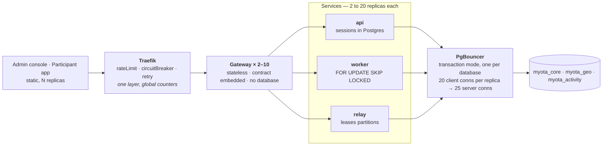

# Horizontal scaling

**Every workload in this system runs at N replicas with no session affinity.** This
document is the contract that makes that true, the specific things that break when
you add a replica, and the mechanism that prevents each.



Every box in that diagram can be deleted at any moment. The tiers are listed with
their replica ranges; the mechanisms that keep them independent are the table
below.

The rule is not "design for scale". It is: **any replica must be able to serve any
request at any moment, and killing any replica at any moment must be invisible.**

## The invariant

| Requirement | Meaning |
| --- | --- |
| No local state | A replica holds nothing that another replica needs |
| No affinity | Any request may land on any replica |
| No singleton work on a replica | Recurring or serialised work cannot be tied to a pod |
| Bounded shared resources | Replicas multiply, but connections and partitions do not |
| Idempotent side effects | A duplicated or retried request has one outcome |

A workload that cannot meet these is a bug, not a design choice.

## Where state lives

Nothing in a process. Everything is either in its own database, in object storage,
or is a cache that may vanish between requests.

| Workload | Local state | Durable state | Replicas can be killed mid-request |
| --- | --- | --- | --- |
| `gateway` | none | none — contracts are compiled in | yes |
| `core-api` | none | `myota_core` (sessions, idempotency) | yes |
| `core-worker` | none | `myota_core` (`ops.job`) | yes, job lease expires |
| `core-relay` | none | `myota_core` (`ops.outbox_event`) | yes, lease expires |
| `geodata-api` | none | `myota_geo` + S3 (upload parts) | yes |
| `geodata-worker` | none | `myota_geo` + S3 | yes, job lease expires |
| `geodata-relay` | none | `myota_geo` | yes, lease expires |
| `activity-api` | none | `myota_activity` | yes |
| `activity-worker` | none | `myota_activity` (`ops.job`) | yes, job lease expires |
| `activity-relay` | none | `myota_activity` | yes, lease expires |
| `admin-web` | none | none — static files | yes |
| `participant-web` | none | none — static files | yes |

## The five things that break at N replicas

Each of these is a real failure that appears only when a second replica exists.
Each has exactly one prevention.

### 1. In-process rate limiting multiplies the limit

If the gateway counts requests in memory, `N` replicas means `N × limit`. An
attacker gets `N` times the allowance by opening connections.

**Prevention: rate limiting lives in Traefik**, which is a single ingress layer
in front of the gateway, using its `RateLimit` middleware. It is already deployed,
already the only entry point, and already the right place for a concern that must
be global. The gateway does not rate limit.

Traefik also handles `circuitBreaker`, `retry`, and `inFlightReq`, which are the
other three concerns that must be counted globally. They move off the application
for the same reason.

### 2. Migrations race

`N` replicas starting at once all run migrations, or all try to and some fail.

**Prevention: migrations never run from an application replica.** They run as a
`Job` that the deploy pipeline waits on, holding a Postgres advisory lock so two
deployments cannot apply concurrently:

```
deploy: migration Job ──(success)──► rollout api ──► rollout worker ──► rollout relay
```

The application binary checks a schema version at startup and **refuses to start**
if the database is behind. A replica never migrates; it verifies and serves.

### 3. Scheduled work fires N times

A cron loop inside the API container fires once per replica.

**Prevention: scheduled work is a job with a uniqueness constraint**, not a timer:

```sql
INSERT INTO ops.job (kind, payload, available_at)
VALUES ('entity.retention', '{}', $1)
ON CONFLICT (kind, scheduled_for) DO NOTHING;
```

`scheduled_for` is the bucket the schedule fires in (e.g. the hour). Ten replicas
that all attempt to enqueue the 03:00 run produce **one** row. Claiming then uses
`SKIP LOCKED`, so exactly one replica executes it.

### 4. Two relays publish the same event twice, out of order

`N` relay replicas reading one outbox will duplicate events and scramble order.

**Prevention: the relay shards by partition, and partitions are leased.**

```
ops.event_cursor (source='self', partition, last_seq, lease_owner, lease_until)
```

A relay replica leases a partition with `FOR UPDATE SKIP LOCKED`, publishes that
partition's events in `seq` order, then releases. With `PARTITIONS = 32`, up to 32
relay replicas work concurrently, each owning distinct partitions, and per-subject
order is preserved because a subject maps to one partition.

This replaces "exactly one relay leader per database", which was a hard throughput
ceiling.

### 5. Consumers process the same event twice

Two replicas pull the same cursor range and both do the work.

**Prevention: two layers, either of which is sufficient.**

- The job id **is** the event id, and the insert is `ON CONFLICT DO NOTHING`. A
  duplicate pull produces no duplicate job.
- The consumer checkpoint is advanced inside the same transaction that writes the
  job, so a duplicate is an insert that conflicts and is discarded.

Correctness does not depend on the puller being alone; efficiency does, which is
why partitions are leased rather than duplicated.

## Connection budgeting — the real scaling wall

Replicas are cheap; Postgres connections are not. Default `max_connections` is
100, and every replica holds a pool.

Without a pooler, with 10 api + 10 worker replicas per service and a pool of 10:

```
3 services × 20 replicas × 10 connections = 600 connections > 100 available
```

The system starts failing to connect at around **3 replicas per service**, long
before any CPU limit.

**Prevention: PgBouncer in transaction mode**, one instance per database, in front
of it.

```
api/worker/relay ──► pgbouncer ──► postgres
   pool: 20 each      server pool: 25    max_connections: 200
```

| Layer | Setting | Rationale |
| --- | --- | --- |
| Application pool | 20 connections per replica | Matches concurrency, not replica count |
| PgBouncer server pool | 25 per database | What the database actually serves |
| Postgres `max_connections` | 200 | Headroom for admin, migrations, monitoring |
| Max replicas per service | 20 | 20 × 20 = 400 client connections, absorbed by the pooler |

Transaction mode requires that no session state survives a transaction — no
`SET`, no session-level `LISTEN`, no advisory locks held across statements. The
design already satisfies this: leases are rows, not advisory locks held open, and
`SET LOCAL` is used inside transactions where a setting is needed.

**Advisory locks** are still used, but only for two short, transactional purposes
(migration gating, schedule bucketing) where the lock is held for a transaction
boundary and released. They are compatible with transaction pooling.

## Per-workload scaling profile

| Workload | Replicas | Scales by | Bottleneck when scaled | Signal to scale on |
| --- | --- | --- | --- | --- |
| `gateway` | 2–10 | CPU | network, TLS at Traefik | request rate, p99 |
| `*-api` | 2–20 | CPU | Postgres connections (pooler) | p99 latency, in-flight |
| `*-worker` | 2–20 | job lease | CPU (geodata), DB (core, activity) | queue depth, job age |
| `*-relay` | 1–32 | partition lease | `PARTITIONS` constant | outbox backlog, oldest unpublished age |
| `admin-web` | 2–10 | trivial | none | request rate |
| `participant-web` | 2–20 | trivial | none | request rate |

Upper bounds are configuration, not physics: they are the replica counts at which
the next bottleneck appears, and each has a documented next step.

## Front ends scale trivially, and that is the point

Both front ends are static file trees served by nginx. They have no server-side
runtime, no session, and no template rendering. Adding a replica is adding a copy
of the same bytes.

| Property | Consequence |
| --- | --- |
| Content-hashed asset filenames (`app.7f3c9a.js`) | every asset is immutable, cached forever |
| `Cache-Control: public, max-age=31536000, immutable` on `/assets/*` | browsers and any intermediate cache serve them without hitting a replica |
| `Cache-Control: no-cache` on `index.html` | a deploy is visible immediately |
| No `Set-Cookie`, no session | any replica serves any request; no affinity |
| No server-side data fetching | the API is called from the browser, so the front end never becomes a database client |

The last point matters for scaling: because the front ends never talk to Postgres,
they can go to 50 replicas without consuming a single database connection. They
scale on network throughput alone.

The build is reproducible and byte-identical per commit, so replicas can be
assumed identical without a content hash comparison.

## Real-time behaviour without sticky sessions

Anything that looks live — activation counters, recent spots, import progress —
must not hold a server-side connection to one replica.

| Need | Mechanism | Scales because |
| --- | --- | --- |
| Progress on a long import | poll `GET /v1/imports/{id}` every 2 s with `ETag` | stateless read |
| Live activation counters | poll `GET /v1/activations/{id}?fields=counters` | stateless read |
| Notifications | poll `GET /v1/notifications?after=` | stateless read, cursor |
| Upload progress | client-side from the S3 part response | no server involvement |

No WebSocket, no server-sent events, no in-memory pub/sub to browsers. The
latency cost is up to one poll interval, which is acceptable for every one of
these and is the trade that makes N-replica serving free.

If a genuinely push-based feature is ever required, the mechanism is a cursor
poll over a long-lived HTTP request that any replica can serve — never a
connection pinned to the replica that happened to accept the WebSocket.

## Uploads stay off the API path

`geodata-api` accepts a 1 GiB shapefile. Proxying those bytes through an
application replica makes the API a bandwidth bottleneck and doubles the memory
requirement, and it scales badly: N replicas each carry their own stream.

**Prevention: presigned S3 URLs.** The API mints a presigned URL per part; the
browser uploads directly to object storage; the API only records the completion.

```
POST /v1/imports                 → uploadId + presigned part URLs
PUT  {presigned url}  (browser → S3, not through the cluster)
POST /v1/imports/{id}/complete   → API verifies size + checksum, enqueues the job
```

The API's CPU cost per upload becomes independent of file size. This is the single
largest scaling improvement to the geodata path.

## Autoscaling

Metrics that are already exposed and are the right HPA inputs:

| Workload | HPA metric | Target | Notes |
| --- | --- | --- | --- |
| `gateway` | CPU | 60% | thin proxy, CPU tracks throughput |
| `*-api` | CPU + in-flight requests | 65% / 50 | in-flight catches queueing before CPU does |
| `*-worker` | `ops_job_queued` | > 50 per replica | queue depth, not CPU — a big import pins one core |
| `*-relay` | `outbox_unpublished_age_seconds` | > 30 s | scale out until backlog clears, capped at `PARTITIONS` |
| `*-web` | CPU | 70% | static serving is CPU-cheap |

`geodata-worker` needs one extra rule: it is memory-bound, not CPU-bound, and a
single import can legitimately use 1.5 GiB. Its HPA scales on queue depth with a
**floor of 2 replicas**, so one long import never blocks the queue entirely.

## Validation

These are testable claims, not aspirations. The checks:

1. **Kill test.** Delete a random replica of each workload during a load test; no
   request fails and no job is lost or duplicated.
2. **Connection test.** Scale every service to its documented maximum and confirm
   Postgres connection count stays under `max_connections`.
3. **Duplicate test.** Run two relays on the same partition set and assert each
   event is published exactly once per consumer.
4. **Affinity test.** Disable session affinity on every Service and run the
   end-to-end suite.
5. **Trim test.** Stall a consumer, advance the clock past the ack floor, and
   assert the producer does not trim past it.

A change that makes any of these fail is a regression in the scaling contract,
regardless of what it improves elsewhere.
