# UI mockups

Static renders of the ten interface screens. These are images because GitHub
shows HTML as source rather than rendering it — the interactive versions are the
`.html` files in this directory, and `renders/` holds the viewable form.

Both applications share one design system (`assets/mockup.css`), follow the OS
light/dark preference, and are responsive from 390 px upward.

Regenerate after any change:

```sh
node tools/render_mockups.mjs          # writes renders/*.png
node tools/render_mockups.mjs --check  # fails if a render is stale
```

---

## Admin console

Separate login, MFA required, session audience `admin`.

### Operations overview

Queue depth, import runs, service health with replica counts.

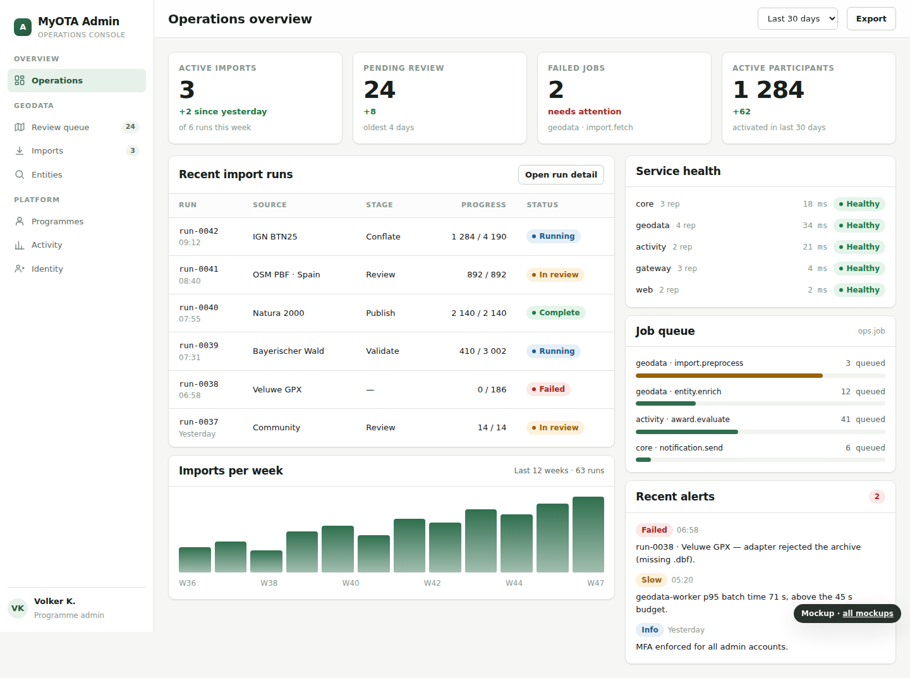

### Geodata review

Candidate queue beside the map, with provenance and a conflation warning.

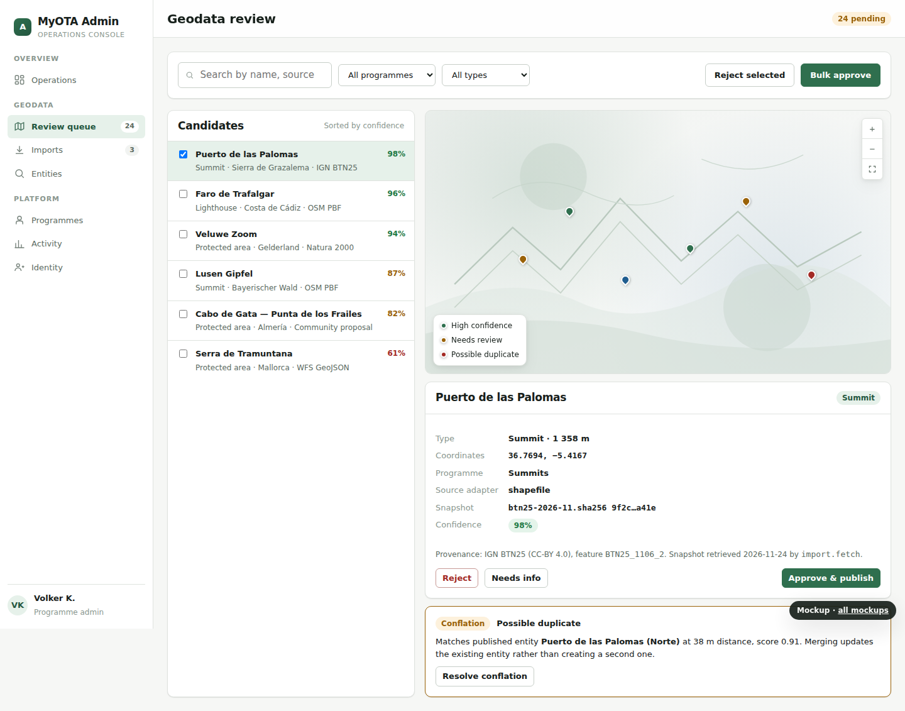

<p align="center">
  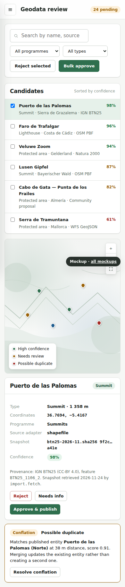
</p>

### Import run detail

Five-stage pipeline, counters, errors, and the worker lease.

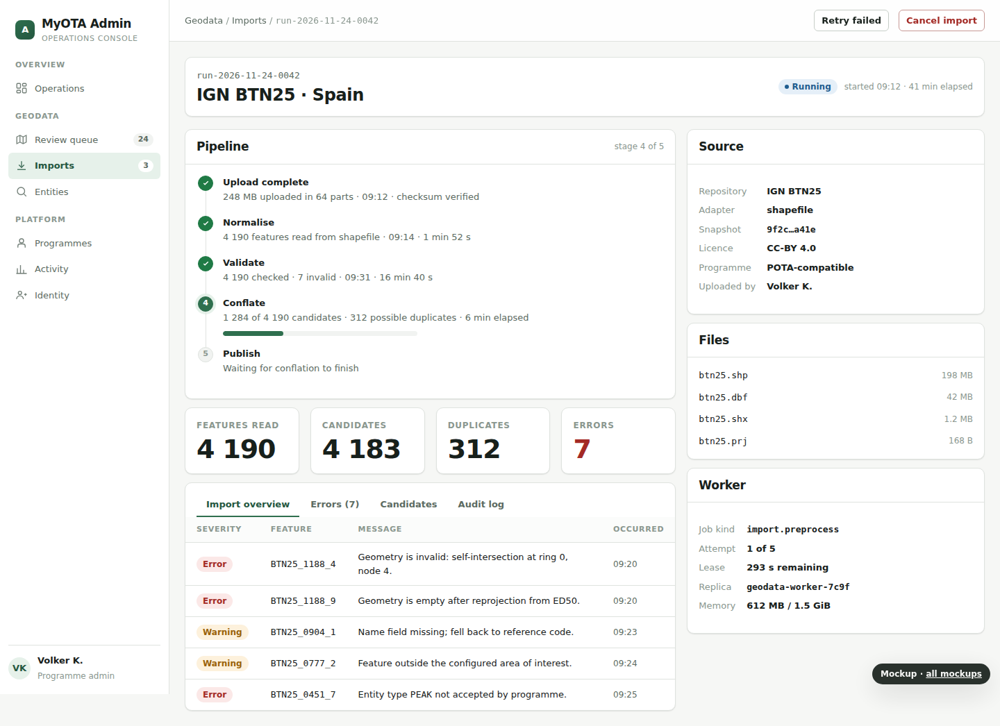

### Programmes and awards

Programme table, award conditions, policy draft review.

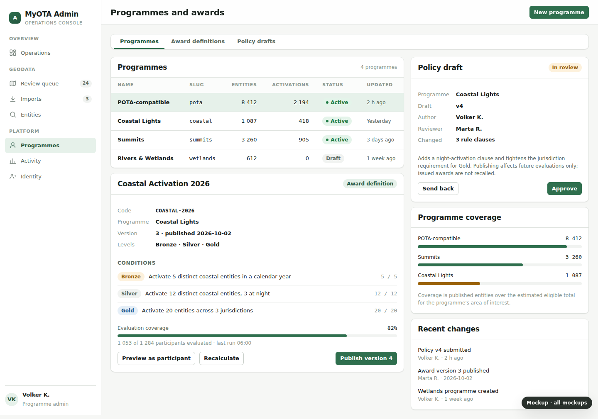

---

## Participant app

Separate login, mobile-first, session audience `participant`.

### Discover

Search, quick actions, nearby places, personal progress.

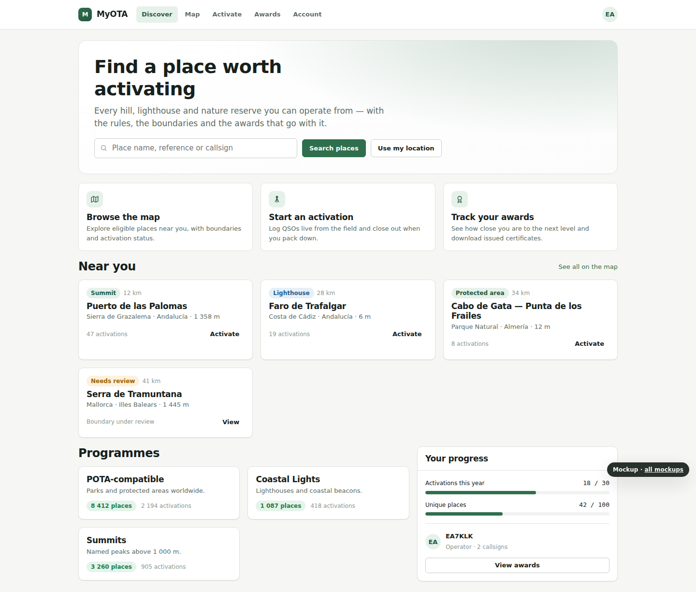

### Map explorer

Full-bleed map with a place detail sheet and a nearby table.

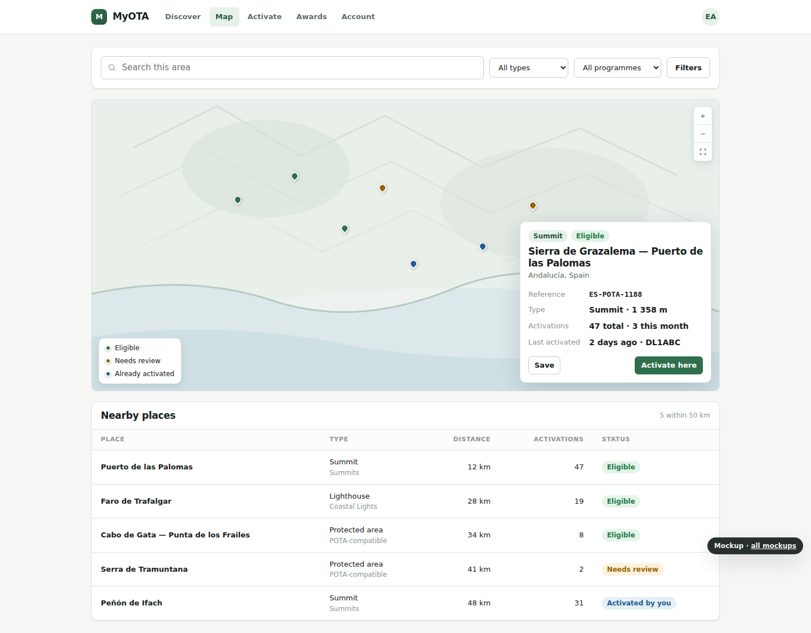

<p align="center">
  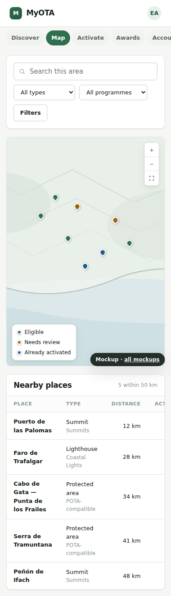
</p>

### Live activation

Elapsed timer, QSO logging form, band breakdown, recent contacts.

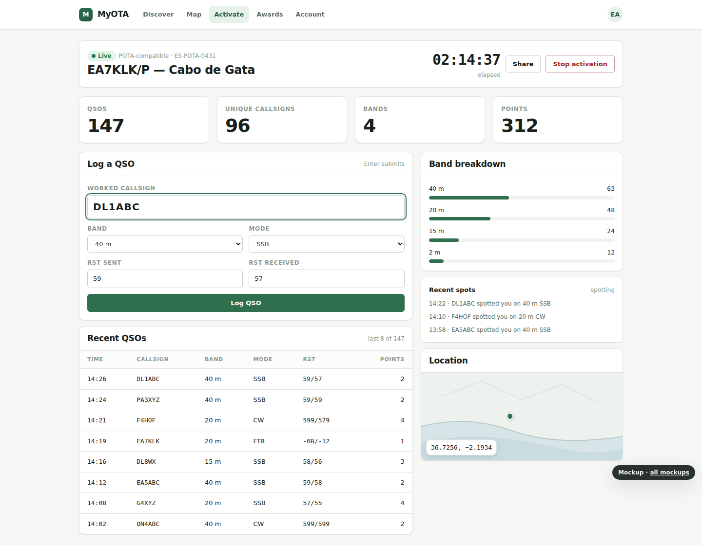

### Awards

Award cards with progress, issued certificates, next milestone.

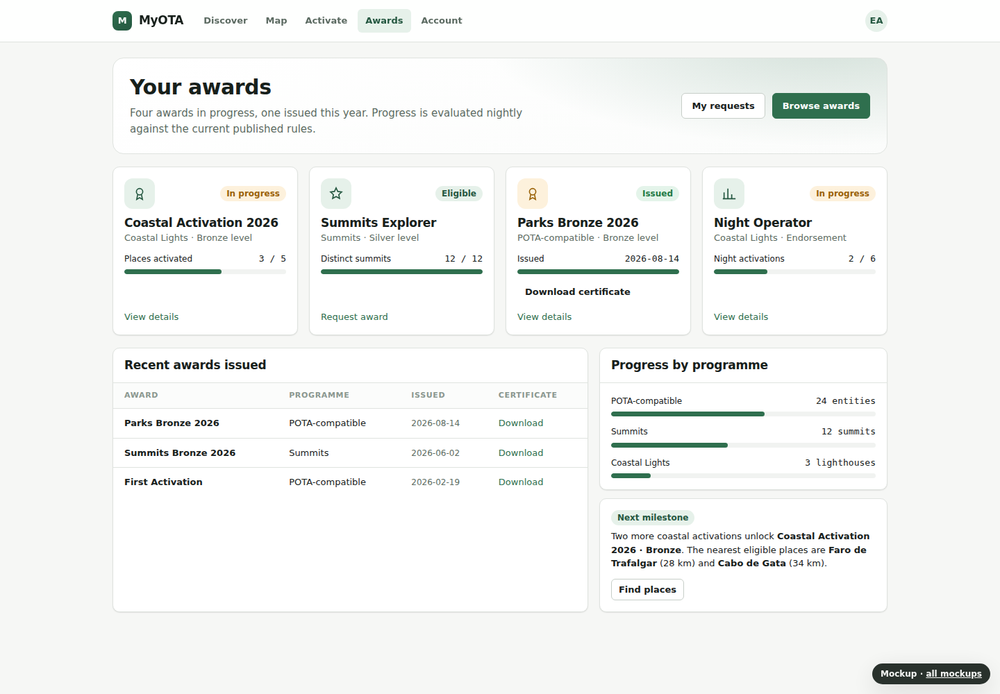

### Check your email

Shown immediately after registration. The address is repeated back, the token
lifetime is stated, and the resend limit is honest — three per hour.

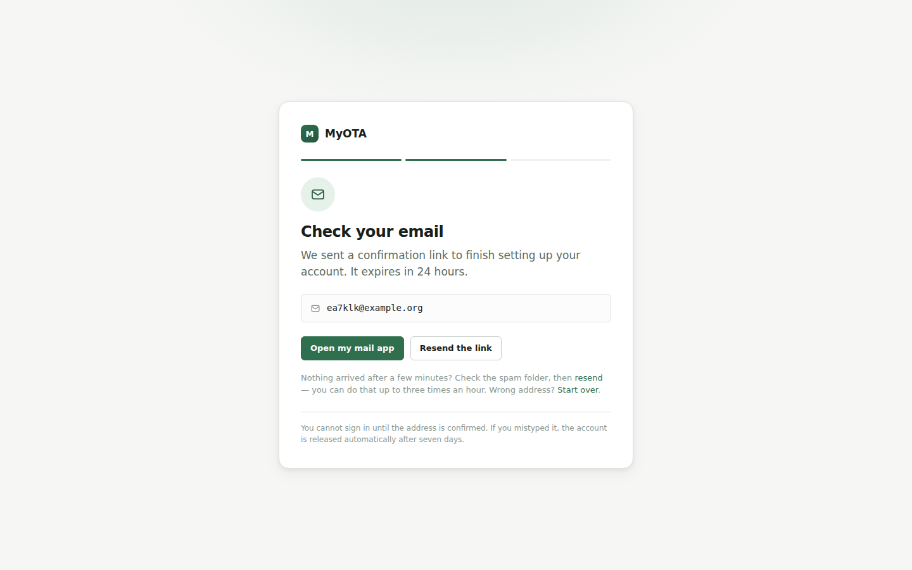

<p align="center">
  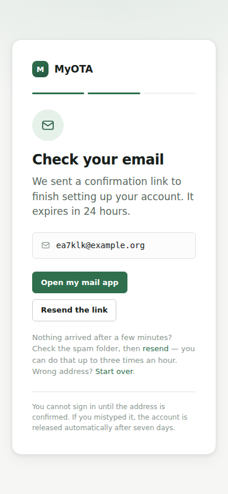
</p>

### Set a new password

Landed from a recovery link. States the 30-minute token lifetime, shows which
requirements are met, and warns that saving signs the account out everywhere.

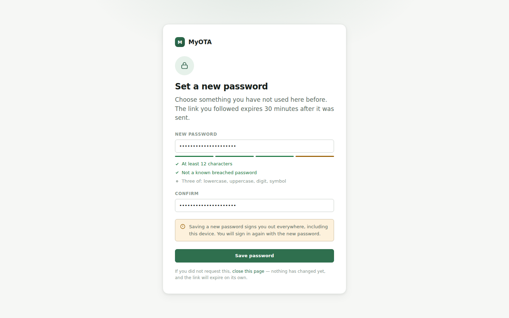

---

## What these are, and are not

They are static mockups: no framework, no network requests, no application logic.
They exist to fix layout and information density before implementation.

They are **not** a specification of behaviour — see
[`../architecture/`](../architecture/README.md) for what the screens are backed by,
and [`../architecture/geodata-imports.md`](../architecture/geodata-imports.md) for
the pipeline the review screen reflects.

Note one deliberate omission: the mockups show no admin navigation inside the
participant app, and no participant navigation inside the admin app. That is the
audience separation made visible — the two applications are not two views of one
shell.
