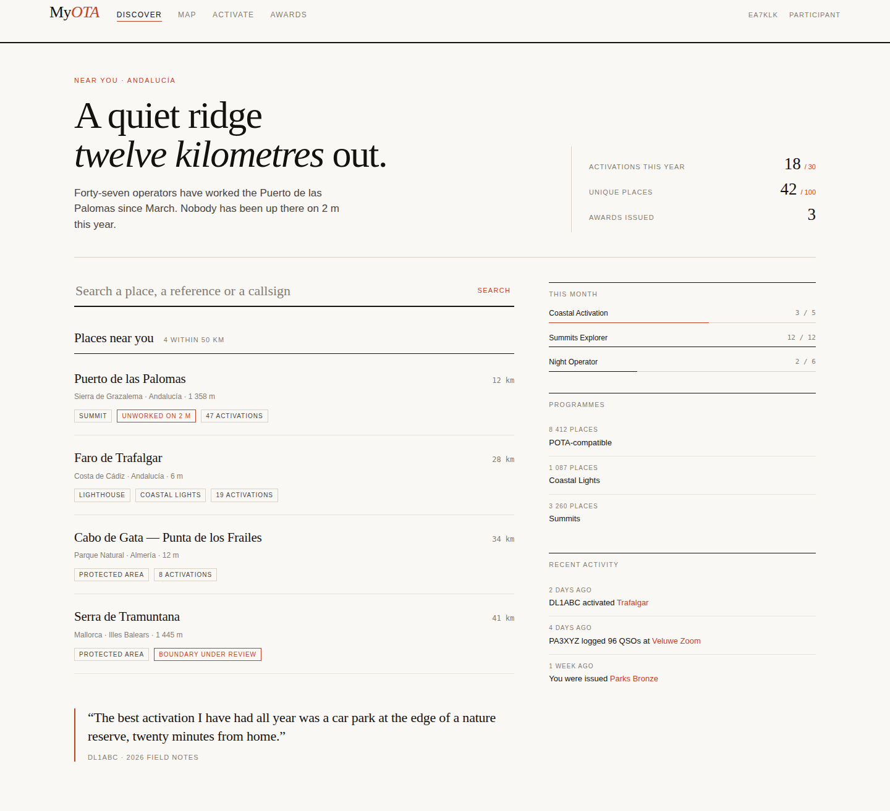
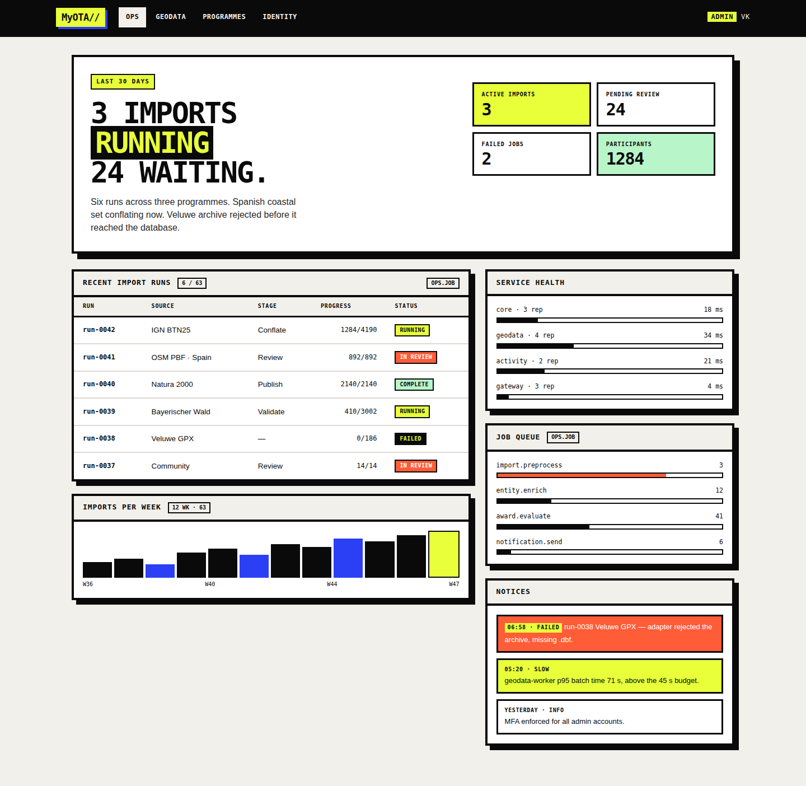
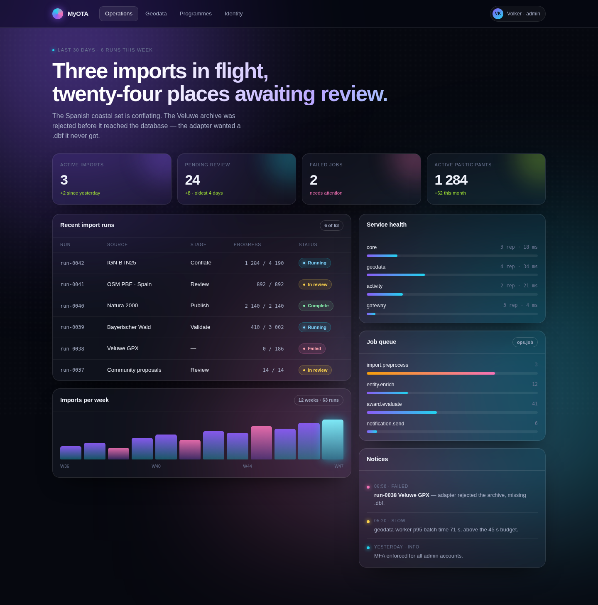
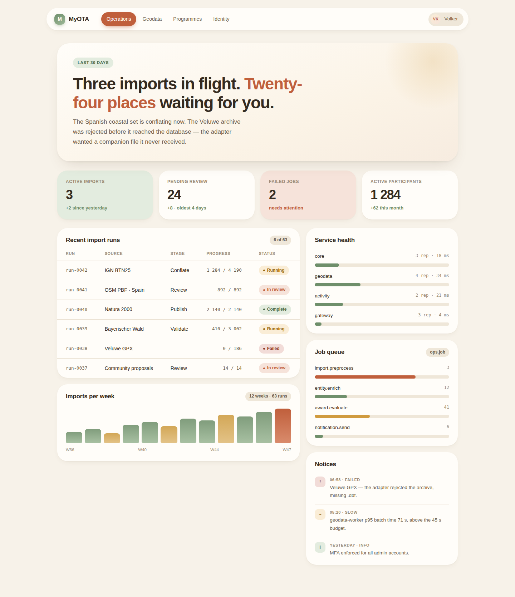
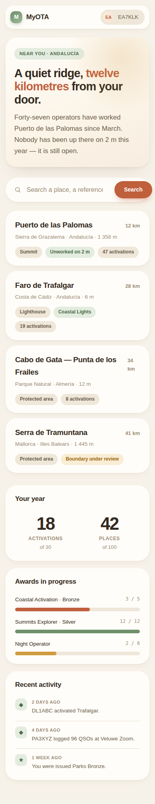

# Four design directions

The same two screens — an admin operations overview and a participant discover
page — drawn in four deliberately different visual languages. Identical content
and information hierarchy; different voice.

Open **[index.html](index.html)** in a browser to compare them side by side, or
read the renders below, which GitHub can display.

| | Direction | Character | Shape | Accent |
| --- | --- | --- | --- | --- |
| 01 | [Editorial](#01--editorial) | serif display, hairline rules, ruled tables | square | vermillion |
| 02 | [Neo-brutalist](#02--neo-brutalist) | monopace capitals, hard shadows | none | acid + electric |
| 03 | [Aurora glass](#03--aurora-glass) | frosted panels over a colour field | 18 px | violet → cyan |
| 04 | [Warm organic](#04--warm-organic) | sand paper, soft shadows, humanist type | 28 px | clay + sage |

Each directory is self-contained: one `style.css`, two pages, one `renders/`
folder. No framework, no network request, no shared base — the styles share
nothing on purpose, so nothing constrains them toward a common average.

---

## 01 · Editorial

Swiss typographic. A serif display face against a grotesque body, hairline rules,
an asymmetric grid, one vermillion accent. Reads like a considered report rather
than a dashboard — dense in information, generous in whitespace.

**Admin**


**Participant**



Directory: [`01-editorial/`](01-editorial/) · [admin.html](01-editorial/admin.html) · [participant.html](01-editorial/participant.html)

---

## 02 · Neo-brutalist

Thick black rules, hard offset shadows, acid yellow and electric blue. Monospace
headings in capitals, zero border radius. Loud on purpose, and legible at a
glance — the opposite of subtle.

**Admin**



**Participant**


Directory: [`02-brutalist/`](02-brutalist/) · [admin.html](02-brutalist/admin.html) · [participant.html](02-brutalist/participant.html)

---

## 03 · Aurora glass

Deep navy with slow colour fields behind frosted panels. Violet-to-cyan
gradients, hairline borders, glow instead of shadow. Data feels lit from within;
the only direction here that is dark by default.

**Admin**



**Participant**


Directory: [`03-aurora/`](03-aurora/) · [admin.html](03-aurora/admin.html) · [participant.html](03-aurora/participant.html)

---

## 04 · Warm organic

Sand paper, terracotta and sage, very large radii, shadows instead of borders.
Humanist type with generous leading. Soft where the others are sharp — the
direction that reads most like a consumer product and least like an admin tool.

**Admin**



**Participant**


On a phone — the responsive behaviour is visible rather than claimed:

<p align="center">
  
</p>

Directory: [`04-organic/`](04-organic/) · [admin.html](04-organic/admin.html) · [participant.html](04-organic/participant.html)

---

## What is shared, and what is not

**Not shared:** colour, type, spacing scale, shadow language, border treatment,
header pattern, table style, status indicator style. Each style defines its own
custom properties in its own `style.css`; there is no common base file to drift
toward a compromise.

**Shared:** the content. Same six import runs, same four places, same award
progress, same numbers. That is what makes the comparison meaningful — you are
looking at four design decisions applied to one problem, not four different
products.

All four are responsive at 390, 768 and 1440 px, and all four honour
`prefers-reduced-motion`.

## Choosing one

The question is not which looks best in isolation. It is what the product should
feel like to the two audiences:

- **Editorial** suits a programme that wants to read as authoritative — published
  rules, curated places, an organisation with a point of view.
- **Neo-brutalist** suits a tool its users open daily and want to scan in two
  seconds. It trades elegance for immediacy.
- **Aurora glass** suits long evening sessions — a live activation at dusk, or an
  operator watching an import overnight. It is also the most expensive to keep
  consistent as screens multiply.
- **Warm organic** suits a participant-first product where the hobby is the point
  and the software should feel like an invitation, not an instrument.

None of these are exclusive. The admin and participant apps are separate
deployables with separate audiences, and the design system does not have to be
the same for both — only the *product* has to feel like one thing.

## Regenerating

```sh
node tools/render_mockups.mjs          # all 21 renders, including these
node tools/render_mockups.mjs --check  # fails if any render is stale
```

The gallery image at [`renders/index.png`](renders/index.png) is itself one of the
renders, so it is regenerated last, after the thumbnails it embeds exist.
